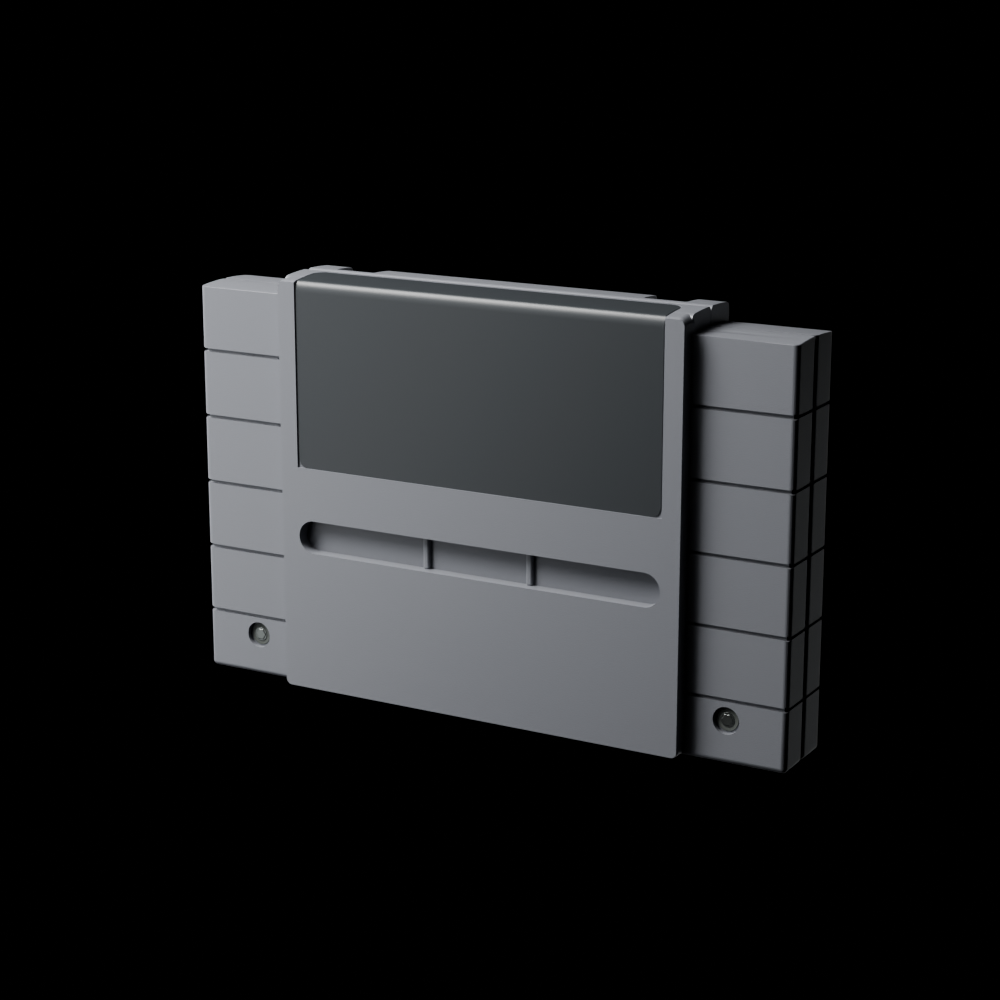
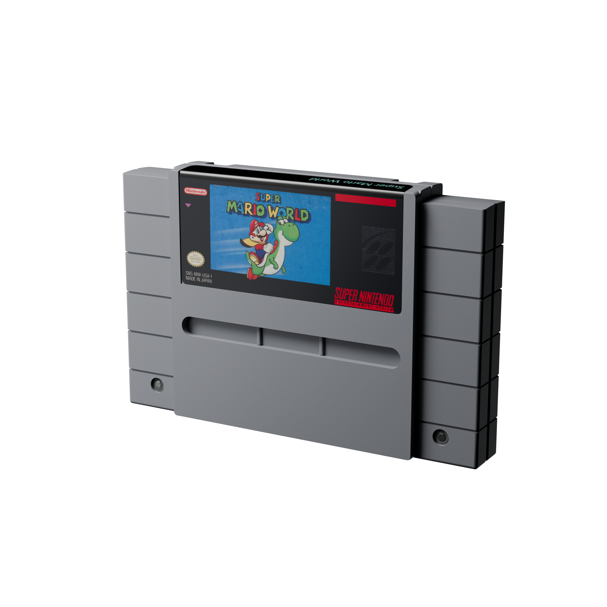

# Retro Cartridge Models

Versioned 3D cartridge reconstructions by **Lincoln Aleixo**. Each model has editable Blender sources, a portable GLB, preview images, a changelog and checksums tied to a release.

**[Explore the public 3D gallery →](https://lincolnaleixo.github.io/retro-cartridge-models/)**

Rotate each model on a black background, inspect six camera angles, browse renders and select published versions on desktop or mobile.



## Organized library

Browse [reproductions](assets/reproductions/README.md) by console and game, or [templates](assets/templates/README.md) by console:

```text
assets/
├── reproductions/
│   ├── snes/super-mario-world/
│   ├── mega-drive/sonic-the-hedgehog/
│   ├── playstation-1/crash-bandicoot/
│   ├── nintendo-64/super-mario-64/
│   └── nes/super-mario-bros/
└── templates/
    ├── snes/
    ├── mega-drive/
    ├── playstation-1/
    ├── nintendo-64/
    └── nes/
```

These are the actual asset directories. Each contains the model's documentation, credits, changelog, version manifests and preview images. The catalog points directly to this hierarchy. Editable Blender sources and GLB exports remain in their verified release packages. To collect those files in the same console/game layout for offline use, run:

```sh
python3 tools/build_library.py
```

Open `dist/library/index.html` for the visual index. Each game or console folder contains the current released Blender source, GLB, previews, credits, original ZIP and `release-manifest.json`. The builder verifies archive and payload checksums before copying files; `inventory.json` records every generated file except itself. The current versions come from `catalog.json`, and existing release packages remain unchanged.

Use a different destination or a local ZIP cache when needed:

```sh
python3 tools/build_library.py --output dist/library-review --cache-dir path/to/release-zips
```

The cache accepts the original ZIP filenames directly, such as `mega-drive-0.1.0.zip`. Missing packages are downloaded from their immutable GitHub release URLs. Existing cache files must pass verification. The output must be a new directory: the builder never overwrites an existing folder, even if empty. Generated binaries stay in ignored `dist/` by default. Git tracks the asset records, previews and tooling; release packages hold the model binaries. Templates retain their published licensing terms, and reproductions retain explicit third-party artwork exclusions.

## Models

| Model | Current version | Files | Changes |
| --- | --- | --- | --- |
| [SNES — early North American shell](assets/templates/snes/README.md) | 0.1.0 | [Download release](https://github.com/lincolnaleixo/retro-cartridge-models/releases/tag/snes-ntsc-u-v0.1.0) | [Changelog](assets/templates/snes/CHANGELOG.md) |
| [SNES — Super Mario World example](assets/reproductions/snes/super-mario-world/README.md) | 0.1.1 | [Download release](https://github.com/lincolnaleixo/retro-cartridge-models/releases/tag/snes-super-mario-world-v0.1.1) | [Changelog](assets/reproductions/snes/super-mario-world/CHANGELOG.md) |
| [Mega Drive — western cartridge](assets/templates/mega-drive/README.md) | 0.1.0 | [Download release](https://github.com/lincolnaleixo/retro-cartridge-models/releases/tag/mega-drive-v0.1.0) | [Changelog](assets/templates/mega-drive/CHANGELOG.md) |
| [PlayStation 1 — standalone CD](assets/templates/playstation-1/README.md) | 0.1.0 | [Download release](https://github.com/lincolnaleixo/retro-cartridge-models/releases/tag/playstation-1-v0.1.0) | [Changelog](assets/templates/playstation-1/CHANGELOG.md) |
| [Mega Drive — Sonic the Hedgehog example](assets/reproductions/mega-drive/sonic-the-hedgehog/README.md) | 0.1.0 | [Download release](https://github.com/lincolnaleixo/retro-cartridge-models/releases/tag/mega-drive-sonic-the-hedgehog-v0.1.0) | [Changelog](assets/reproductions/mega-drive/sonic-the-hedgehog/CHANGELOG.md) |
| [PlayStation 1 — Crash Bandicoot disc example](assets/reproductions/playstation-1/crash-bandicoot/README.md) | 0.1.0 | [Download release](https://github.com/lincolnaleixo/retro-cartridge-models/releases/tag/playstation-1-crash-bandicoot-v0.1.0) | [Changelog](assets/reproductions/playstation-1/crash-bandicoot/CHANGELOG.md) |
| [Nintendo 64 — NTSC-U/C cartridge](assets/templates/nintendo-64/README.md) | 0.2.0 | [Download](https://github.com/lincolnaleixo/retro-cartridge-models/releases/tag/nintendo-64-v0.2.0) | [Changelog](assets/templates/nintendo-64/CHANGELOG.md) |
| [NES — early five-screw cartridge](assets/templates/nes/README.md) | 0.1.0 | [Download release](https://github.com/lincolnaleixo/retro-cartridge-models/releases/tag/nes-v0.1.0) | [Changelog](assets/templates/nes/CHANGELOG.md) |
| [Nintendo 64 — Super Mario 64 reproduction](assets/reproductions/nintendo-64/super-mario-64/README.md) | 0.2.0 | [Download](https://github.com/lincolnaleixo/retro-cartridge-models/releases/tag/nintendo-64-super-mario-64-v0.2.0) | [Changelog](assets/reproductions/nintendo-64/super-mario-64/CHANGELOG.md) |
| [NES — Super Mario Bros. reproduction](assets/reproductions/nes/super-mario-bros/README.md) | 0.1.0 | [Download release](https://github.com/lincolnaleixo/retro-cartridge-models/releases/tag/nes-super-mario-bros-v0.1.0) | [Changelog](assets/reproductions/nes/super-mario-bros/CHANGELOG.md) |

Nintendo 64 template and Super Mario 64 reproduction 0.2.0 include eight actual-export views, including a native rear-detail camera. Both pass GLB inspection, editable-source reopening and Godot 4.7.2 import and surface checks. The published [Nintendo 64 template 0.1.0](https://github.com/lincolnaleixo/retro-cartridge-models/releases/tag/nintendo-64-v0.1.0) and [Super Mario 64 0.1.0](https://github.com/lincolnaleixo/retro-cartridge-models/releases/tag/nintendo-64-super-mario-64-v0.1.0) packages remain available unchanged.

### Super Mario World example

[](https://lincolnaleixo.github.io/retro-cartridge-models/#snes-super-mario-world)

The existing textured demonstration is also available in the gallery and as its own versioned package. Nintendo artwork and marks are excluded from the original-contributions license; [source credits and rights scope](assets/reproductions/snes/super-mario-world/CREDITS.md) remain explicit.

The initial public model uses neutral, unprinted labels. It includes the curved top, the label folded around that curve, rounded side details, and blind lower latch recesses with solid backing. Dimensions are estimates from physical references, not official manufacturing drawings.

## Download and use

### Mega Drive and PlayStation

The [Mega Drive cartridge](assets/templates/mega-drive/README.md) and [standalone PlayStation CD](assets/templates/playstation-1/README.md) have neutral 0.1.0 packages in the catalog. PlayStation uses only the CD; the earlier case study remains historical source. Separate 0.1.0 textured examples provide [Sonic the Hedgehog](assets/reproductions/mega-drive/sonic-the-hedgehog/README.md) and [Crash Bandicoot](assets/reproductions/playstation-1/crash-bandicoot/README.md), with editable Blender sources and self-contained GLBs. Sonic uses the original-resolution photographic label; Crash uses an approximately restored orange and blue-violet print. Their credits identify sources and third-party rights exclusions. The neutral models stay unchanged, and the [artwork mapping tool](docs/owner-artwork.md) still supports local studies.

The geometry follows [documented dimensional evidence](docs/measurement-evidence-2026-10-02.json). These are visualization reconstructions, not certified replacement parts. The SNES surface refinement remains development work; its published baseline is unchanged.

### Nintendo 64 and NES

The [Nintendo 64 template](assets/templates/nintendo-64/README.md) targets the original North American NUS-006 Game Pak, with a nominal 116 × 76.6 × 18.5 mm envelope. The [NES template](assets/templates/nes/README.md) targets the early western five-screw shell at approximately 119.7 × 134 × 16.75 mm. Both have unprinted front and rear artwork surfaces, editable Blender sources and original procedural ABS maps. Nintendo 64 0.2.0 uses official Nintendo website SVG contours for the rear lettering, adapted into an approximate molded island and recess; the mark remains excluded from the model license. The NES template omits that lettering.

The Nintendo 64 0.2.0 refinement provides continuous crown and cheek shading, domed gold-toned Gamebit heads, a continuous black connector guide, tan exposed PCB substrate and more visible fine rear grain. The nominal envelope, North American regional keys, label dimensions, axes and pivot remain stable. The Super Mario 64 reproduction retains its existing photo pixels, UV mapping and print settings; the changes concern the shared shell and visible hardware. Official 2D mark contours do not make the inferred relief or hardware dimensions manufacturing specifications.

Separate reproductions provide [Super Mario 64](assets/reproductions/nintendo-64/super-mario-64/README.md) with its original US K-A front and 1996 rear label, and [Super Mario Bros.](assets/reproductions/nes/super-mario-bros/README.md) with the early round gold seal, folded top title and rear warning label without REV-A. Both map unmodified photographic artwork. The Nintendo 64 front source has limited fine-print resolution, and the NES top fold comes from a small, oblique photographed region. Their credits identify source photography and reserved third-party rights; attribution is not a permission grant.

The [Nintendo 64 evidence](docs/nintendo-64-reference-evidence.json) and [NES evidence](docs/nes-reference-evidence.json) distinguish published measurements from details inferred from photographs. These are visualization assets rather than tested replacement shells.

### Generate models locally

Generate all four parametric models—Mega Drive, PlayStation 1, Nintendo 64 and NES—with Blender 5.2.2:

```sh
blender --factory-startup -b --python tools/create_media_models.py -- --output dist/development
```

Use `--only nintendo-64`, `--only nes`, `--only mega-drive` or `--only playstation-1` to build one model. The [artwork workflow](docs/owner-artwork.md) supports front and rear photos, separate cartridge top folds, and rectangular or quadrilateral UV regions.

For the SNES refinement, download and verify the 0.1.0 package above, extract it locally, then run:

```sh
blender --factory-startup -b path/to/snes-ntsc-u.blend --python tools/refine_snes.py -- dist/development/snes-ntsc-u
python3 tools/inspect_glb.py dist/development/snes-ntsc-u/snes-ntsc-u.glb
python3 tools/verify.py
```

Generated sources, GLBs and renders remain in the ignored `dist/` directory. Review actual exports and engine import before preparing a versioned release; existing packages and checksums stay unchanged.

Download the model package from its release. It contains the `.blend`, self-contained `.glb`, previews, license, credits and a file manifest. The GLB uses meters: **X = width, Y = up, +Z = front**, with its origin near the bottom connector center. Import it into Godot or another glTF-compatible tool at scale 1.

Large source/export files live in versioned release packages; Git tracks the catalog, manifests, documentation, tools and previews. The download address and SHA-256 of each package are recorded in Git. You can retrieve a specific version and compare it with the next one without guessing which file is current.

```sh
python3 tools/verify.py
python3 tools/verify.py --download snes-ntsc-u 0.1.0
```

See [VERSIONING.md](VERSIONING.md) for the release workflow and comparison rules.

Before contributing changes, read [rules.md](rules.md). Every change requires a [collection changelog](CHANGELOG.md) update; model changes also belong in that model's changelog.

## Gallery publishing

The GitHub Pages gallery is generated from `catalog.json` and the version manifests. Add a model's display title, description, credits and rights summary to the catalog; publish its verified release package. The Pages workflow builds and deploys on main-branch changes and published releases.

To preview locally, run `python3 tools/build_site.py`, then `python3 -m http.server 8080 --directory _site`. The builder downloads and verifies release archives and copies only the site, GLBs, previews and public notices into `_site`. Model binaries stay outside Git; the browser loads them from the same Pages origin. `site/vendor/` contains the pinned viewer and its software license.

## License and attribution

Original contributions are licensed under **[CC BY-NC-ND 4.0](https://creativecommons.org/licenses/by-nc-nd/4.0/)**: attribution is required, commercial use is not licensed, and adapted material may not be redistributed under this license. The full terms are in [LICENSE](LICENSE). This is a public, source-available collection, not an OSI open-source software project.

Suggested credit:

> SNES NTSC-U cartridge reconstruction v0.1.0 by Lincoln Aleixo — Retro Cartridge Models — CC BY-NC-ND 4.0. https://github.com/lincolnaleixo/retro-cartridge-models

Existing hardware designs, product names, trademarks and any separately identified third-party content are outside this license grant. See [NOTICE.md](NOTICE.md) and [CREDITS.md](CREDITS.md). This collection is independent and is not affiliated with Nintendo.
