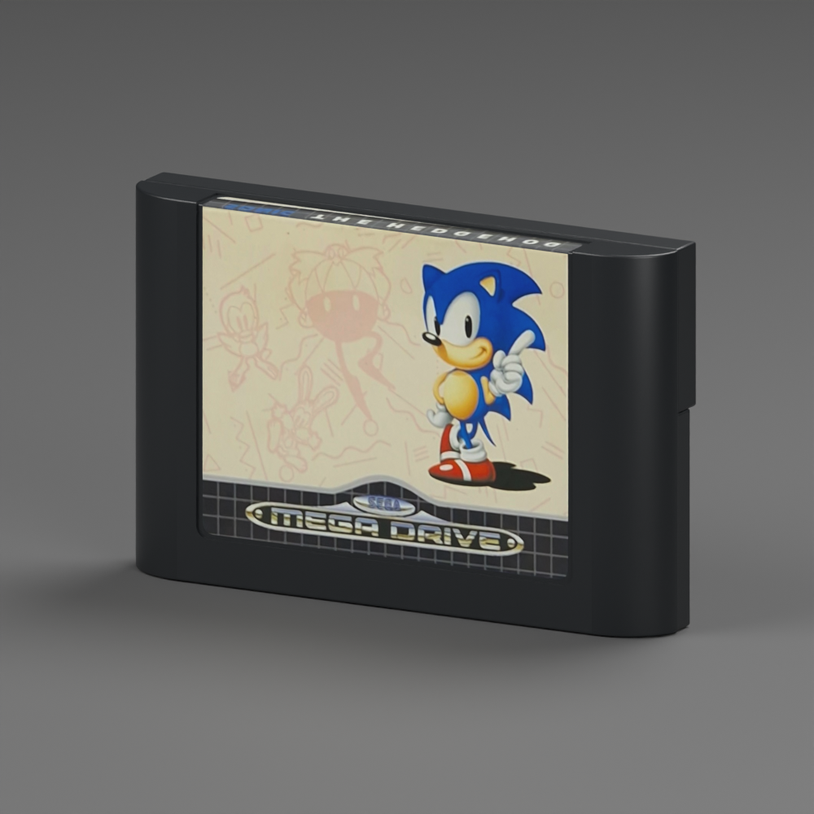

# Mega Drive — Sonic the Hedgehog example

**Version:** 0.1.0 · **Reconstruction:** Lincoln Aleixo

[Explore in 3D](https://lincolnaleixo.github.io/retro-cartridge-models/#mega-drive-sonic-the-hedgehog) · [Download release](https://github.com/lincolnaleixo/retro-cartridge-models/releases/tag/mega-drive-sonic-the-hedgehog-v0.1.0) · [Changelog](CHANGELOG.md)

Sonic the Hedgehog (1991) on the western PAL Mega Drive cartridge shell. The front and folded top label use the original-resolution product photographs, with unchanged source pixels and separate UV regions. The front artwork region has approximately 954 × 748 source pixels, compared with roughly 327 × 256 in the earlier local study. The rear label area remains neutral.

The package includes packed editable Blender source, a self-contained GLB, previews and provenance. Geometry, ABS surface detail, scale, axes and label UVs follow the neutral `mega-drive` 0.1.0 shell. The nominal envelope is 109 × 70 × 17 mm; units are meters, X is width, Y is up and +Z is front, with a bottom-center pivot. This is an approximate reconstruction for visualization, not Sega manufacturing CAD.

The printed label uses sRGB artwork, roughness 0.68 and reduced dielectric specular reflection. Previews use neutral lighting to limit unwanted color casts. Photographic color and perspective remain approximate. Godot 4.7.2 consumers should preserve each label surface's texture and apply the documented specular compensation in [owner artwork](../../docs/owner-artwork.md).

This separately versioned example leaves the released neutral shell unchanged. Publish and verify the model package before updating a consuming application.

Original reconstruction contributions are CC BY-NC-ND 4.0. Sonic the Hedgehog artwork, SEGA marks and source photography are excluded from that grant. This independent example is not an official Sega asset and does not grant a license to its third-party elements. See [credits](CREDITS.md) and the root [NOTICE.md](../../NOTICE.md).
