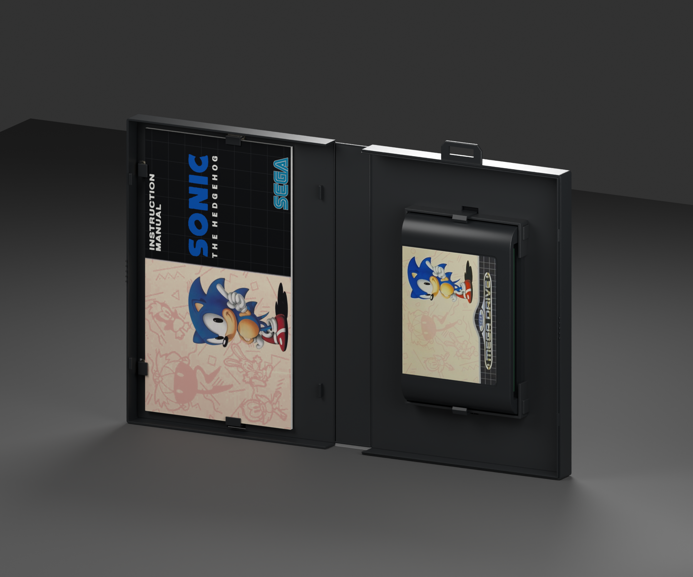

# Mega Drive — Sonic the Hedgehog box reproduction

**Version:** 0.3.0 · **Date:** 2026-10-16 · **Creator:** Lincoln Aleixo

A fresh Sonic the Hedgehog clamshell with the PAL wrap, restored booklet covers, intact retail hanger, articulated spine and matching removable cartridge.

## Edition and contents

Selected edition: **Western PAL Mega Drive presentation**. This reproduction uses the independently released [mega-drive neutral box template v0.3.0](https://github.com/lincolnaleixo/retro-cartridge-models/releases/tag/mega-drive-box-v0.3.0), with the same packaging geometry, hinge hierarchy, normalized print UVs and opening animation. The matching [mega-drive-sonic-the-hedgehog v0.2.0](https://github.com/lincolnaleixo/retro-cartridge-models/releases/download/mega-drive-sonic-the-hedgehog-v0.2.0/mega-drive-sonic-the-hedgehog-0.2.0.zip) is enclosed at its original scale beneath a removable `Contents` parent. Its published geometry, materials and embedded artwork are preserved exactly; its pinned manifest, original credits and provenance are included in `content-source/`. The standalone cartridge/disc release remains unchanged. Contact positions are approximate rigid visualizations; flexible paper and plastic deformation are not simulated. Printed booklet covers, where present, surround approximate blank interior leaves rather than a complete reproduced manual.

The shell and print aim for a pristine, newly unboxed appearance. Original glyph contour reconstruction, clean measured grid, bounded paper/color restoration and original illustration denoise. Chrome plate silhouette and reflection bands are explicitly reconstructed; clean archived SEGA vector supplies the wordmark. Contours and flat colors are restored approximations of the original print, not recovered factory vectors. Original screenshots and shaded character art retain source-resolution limits. Colors are visually estimated. Original Sonic title and type contours are traced into antialiased flat ink; the decorative grid is measured and redrawn. These are restored approximations, not recovered factory vectors. Chrome Mega Drive plate silhouette and silver/gold reflection bands are reconstructed from the documented original logo; the archived clean SEGA wordmark supplies the logo lettering. Original shaded Sonic illustration and four rear screenshots retain source-resolution limits. Pink/cream paper fields and black fields are cleaned independently of character shading. Colors are visually estimated, not calibrated. Restoration is a visual approximation rather than proof of original ink values, manufacturing tolerances or missing lettering. Upsampling does not add authentic detail. Paper texture, scan blur and small source imperfections may remain visible at close range.

## Prepared artwork

| Artwork slot | Approximate effective source pixels | Prepared image pixels | Release file |
| --- | --- | --- | --- |
| `Front` | See per-face provenance | 2882 × 4052 | `artwork/Front.png` in release ZIP |
| `Spine` | See per-face provenance | 560 × 4052 | `artwork/Spine.png` in release ZIP |
| `Back` | See per-face provenance | 2800 × 4052 | `artwork/Back.png` in release ZIP |
| `BookletFront` | See per-face provenance | 2190 × 3860 | `artwork/BookletFront.png` in release ZIP |
| `BookletBack` | See per-face provenance | 2190 × 3856 | `artwork/BookletBack.png` in release ZIP |

Every listed PNG is embedded byte-for-byte in its GLB artwork slot and included separately in the release for reproducible application. The package contains the used prepared faces, their source citations and transformation provenance; it does not include unused research photographs or raw specimen images. Separate files do not grant additional rights to the artwork.

## Import and validation

| Property | Value |
| --- | --- |
| Units and axes | Meters; X width, Y up, +Z front |
| Pivot | Bottom center of the nominal closed envelope |
| Nominal closed size | 129 × 188 × 26 mm |
| Initial pose | Closed |
| Animation | `Open`, 0 to 2 seconds |

The self-contained GLB passed structural, image, UV, hierarchy and animation checks. Direct comparison of its box subset with the neutral template verified identical positions, normals, artwork UVs, triangle indices, node transforms and animation keys. The exporter rounded 52 non-artwork UV scalars by at most 1.91e-06; this is recorded separately and does not change any printed-face UV coordinates. The added contents are checked separately against their pinned source release. Godot 4.7.2-stable (official) imported and evaluated both animation endpoints; Blender 5.2.2 LTS reopened the packed editable source and checked both poses. Release reports bind these checks to exact binary hashes.

The 129 × 177 × 26 mm body and 188 mm height including hanger are nominal estimates from protector fit and specimen photographs. Mold revision, clip offsets, sleeve thickness and booklet pagination are approximate. Flexible spine folds use rigid pivots. Transparent materials and printed-paper highlights can vary between renderers. Godot does not honor the exported specular extension; apply a printed-material specular level of 0.18 when matching the Blender preview lighting.

The release includes editable `.blend`, portable `.glb`, six previews, construction and reference evidence, prepared PNGs, provenance and validation reports. The editable source supports moving or removing `Contents`. Re-exporting through a DCC tool may alter buffer precision. To preserve the original media bytes, use the repository's `tools/compose_box_contents.py` with a print-only box source and the pinned media release. See `content-composition.json` for exact source hashes, parent, placement and preservation checks, and the repository's restoration documentation for the rebuild workflow.

See [credits](CREDITS.md) and [changelog](CHANGELOG.md). Original modeling contributions only: CC BY-NC-ND 4.0. Game artwork, marks, product designs, scans and source photography are excluded. Attribution and the maintainer's request do not grant rights to those elements.
