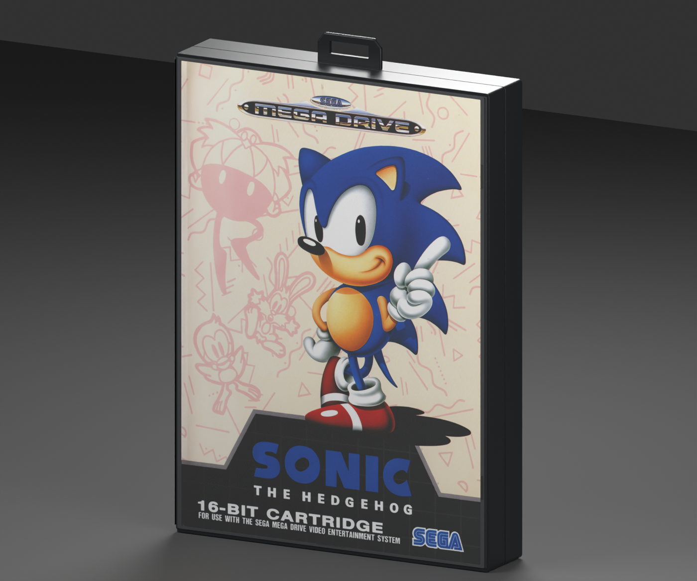
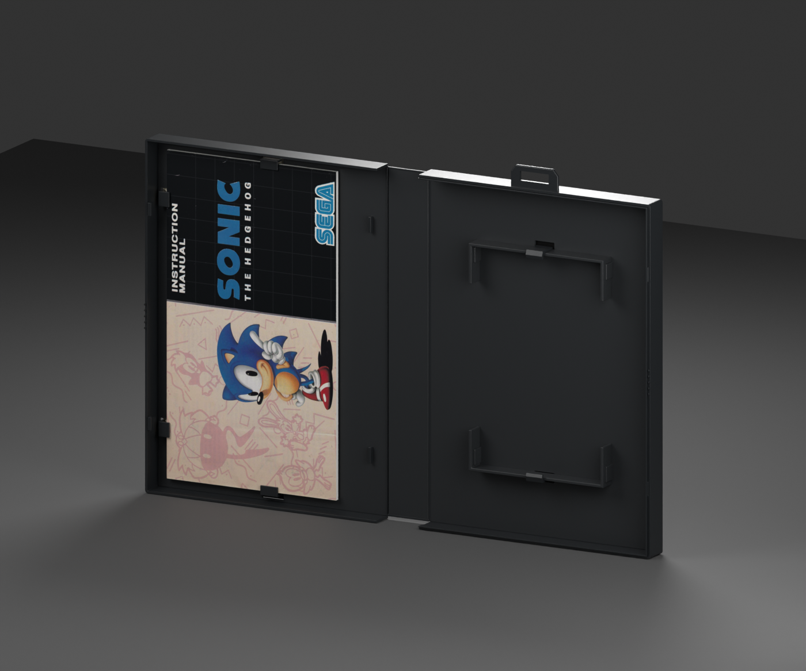

# Mega Drive — Sonic the Hedgehog box reproduction

**Version:** 0.1.0 · **Date:** 2026-10-16 · **Creator:** Lincoln Aleixo

A fresh Sonic the Hedgehog clamshell with the PAL wrap, restored booklet covers, intact retail hanger and articulated spine.

## Edition and contents

Selected edition: **Western PAL Mega Drive presentation**. This reproduction uses the independently released [mega-drive neutral box template](https://github.com/lincolnaleixo/retro-cartridge-models/tree/main/assets/templates/mega-drive/box), with the same packaging geometry, hinge hierarchy, normalized print UVs and opening animation. Cartridge and CD models remain separate assets; no game media is enclosed. Printed booklet covers, where present, surround approximate blank interior leaves rather than a complete reproduced manual.

The shell and print aim for a pristine, newly unboxed appearance. Local scan cleanup; no generated illustration or replacement lettering. Sonic manual empty black/grid fields are restored from measured grid spacing while original foreground print is retained. Source printing and scan resolution are preserved. Fine paper texture and residual minor scan variation remain approximate. Complete outer wrap; no evidence of printed reverse-side wrap. Multilingual English-first rear is authentic to this edition. Small dust and spine fold marks in scan require conservative local repair. Restoration is a visual approximation rather than proof of original ink values, manufacturing tolerances or missing lettering. Upsampling does not add authentic detail. Paper texture, scan blur and small source imperfections may remain visible at close range.

## Prepared artwork

| Artwork slot | Approximate effective source pixels | Prepared image pixels | Release file |
| --- | --- | --- | --- |
| `Front` | 1441 × 2026 | 1441 × 2026 | `artwork/Front.png` in release ZIP |
| `Back` | 1400 × 2026 | 1400 × 2026 | `artwork/Back.png` in release ZIP |
| `Spine` | 280 × 2026 | 280 × 2026 | `artwork/Spine.png` in release ZIP |
| `BookletFront` | 1095 × 1930 | 1095 × 1930 | `artwork/BookletFront.png` in release ZIP |
| `BookletBack` | 1095 × 1928 | 1095 × 1928 | `artwork/BookletBack.png` in release ZIP |

Every listed PNG is embedded byte-for-byte in its GLB artwork slot and included separately in the release for reproducible application. The package contains the used prepared faces, their source citations and transformation provenance; it does not include unused research photographs or raw specimen images. Separate files do not grant additional rights to the artwork.

## Import and validation

| Property | Value |
| --- | --- |
| Units and axes | Meters; X width, Y up, +Z front |
| Pivot | Bottom center of the nominal closed envelope |
| Nominal closed size | 129 × 188 × 26 mm |
| Initial pose | Closed |
| Animation | `Open`, 0 to 2 seconds |

The self-contained GLB passed structural, image, UV, hierarchy and animation checks. Direct comparison with its neutral template verified identical positions, normals, artwork UVs, triangle indices, node transforms and animation keys. The exporter rounded 45 non-artwork UV scalars by at most 1.91e-06; this is recorded separately and does not change any printed-face UV coordinates. Godot 4.7.2-stable (official) imported and evaluated both animation endpoints; Blender 5.2.2 LTS reopened the packed editable source and checked both poses. Release reports bind these checks to exact binary hashes.

The 129 × 177 × 26 mm body and 188 mm height including hanger are nominal estimates from protector fit and specimen photographs. Mold revision, clip offsets, sleeve thickness and booklet pagination are approximate. Flexible spine folds use rigid pivots. Transparent materials and printed-paper highlights can vary between renderers. Godot does not honor the exported specular extension; apply a printed-material specular level of 0.18 when matching the Blender preview lighting.

The release includes editable `.blend`, portable `.glb`, six previews, construction and reference evidence, prepared PNGs, provenance and validation reports. Run the repository's `tools/create_game_boxes.py` from the unpacked release directory, passing `--console mega-drive --asset-id mega-drive-sonic-the-hedgehog-box --artwork artwork-mapping.json --output regenerated`, to rebuild with the included artwork mapping.

See [credits](CREDITS.md) and [changelog](CHANGELOG.md). Original modeling contributions only: CC BY-NC-ND 4.0. Game artwork, marks, product designs, scans and source photography are excluded. Attribution and the maintainer's request do not grant rights to those elements.
