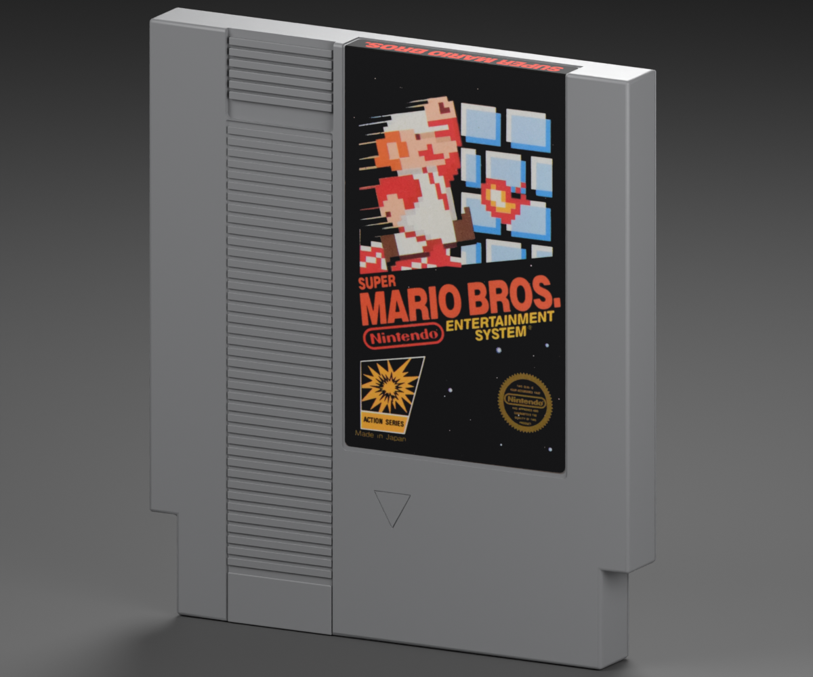

# NES — Super Mario Bros. reproduction

**Version:** 0.2.0 · **Date:** 2026-10-16 · **Reconstruction:** Lincoln Aleixo

[Explore in 3D](https://lincolnaleixo.github.io/retro-cartridge-models/#nes-super-mario-bros) · [Download release](https://github.com/lincolnaleixo/retro-cartridge-models/releases/tag/nes-super-mario-bros-v0.2.0) · [Previous release](https://github.com/lincolnaleixo/retro-cartridge-models/releases/tag/nes-super-mario-bros-v0.1.0) · [Changelog](CHANGELOG.md)

Super Mario Bros. with clean black front ink, preserved original pixel art and stars, a crisp folded top title and a restored early rear warning label without REV-A.

The front uses a soft mask over neutral low-value wear, plus one localized scratch repair. Built-in image generation restores the top title and rear warning print. Measured image registration retains the existing mesh UVs; the top strip retains its original physical orientation.

Nominal dimensions: 119.7 × 134 × 16.75 mm. The published shell, vertex/index data, normals, transforms, material definitions and every mesh UV byte are preserved. Only the selected packed artwork images change. Units remain meters, Y is up and +Z is front; the existing pivot and label surfaces remain compatible. This is a visualization reconstruction, not manufacturing CAD.

The package contains editable packed Blender source, a self-contained GLB, five actual-export views, attribution and restoration/validation records. Blender and Godot compare the previous and restored geometry directly. New and previous exports were rendered under the same neutral studio, Standard view transform, exposure -1.0, 32 Cycles samples and 1200 × 1000 output. Historical previews remain unchanged; the new matched renders isolate the artwork changes.

The target is clean, newly unboxed print. Original edition marks and illustration are preserved; colors and restored fine lettering are approximate, not color-calibrated factory masters. Third-party artwork, marks, product design and photography are excluded from CC BY-NC-ND 4.0, which applies only to original modeling contributions. The maintainer request does not grant those third-party rights. See [credits](CREDITS.md), [changes](CHANGELOG.md) and [NOTICE.md](../../../../NOTICE.md).
