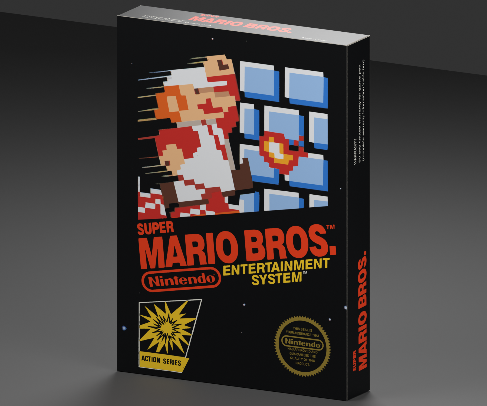
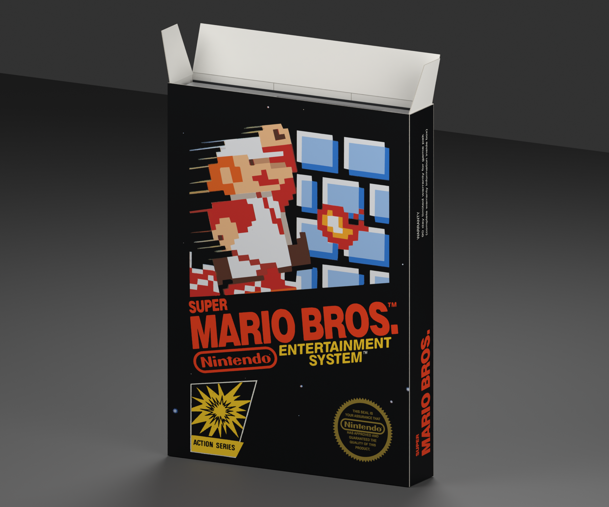

# NES — Super Mario Bros. box reproduction

**Version:** 0.3.0 · **Date:** 2026-10-16 · **Creator:** Lincoln Aleixo

A pristine early Super Mario Bros. carton with articulated tuck lid, dust ears, black sleeve, foam spacer and the matching removable cartridge.

## Edition and contents

Selected edition: **Early US black-box edition with an integrated rear hanger**. This reproduction uses the independently released [nes neutral box template v0.1.0](https://github.com/lincolnaleixo/retro-cartridge-models/releases/tag/nes-box-v0.1.0), with the same packaging geometry, hinge hierarchy, normalized print UVs and opening animation. The matching [nes-super-mario-bros v0.2.0](https://github.com/lincolnaleixo/retro-cartridge-models/releases/download/nes-super-mario-bros-v0.2.0/nes-super-mario-bros-0.2.0.zip) is enclosed at its original scale beneath a removable `Contents` parent. Its published geometry, materials and embedded artwork are preserved exactly; its pinned manifest, original credits and provenance are included in `content-source/`. The standalone cartridge/disc release remains unchanged. Contact positions are approximate rigid visualizations; flexible paper and plastic deformation are not simulated. Printed booklet covers, where present, surround approximate blank interior leaves rather than a complete reproduced manual.

The normal `Open` pose keeps the sleeve/tray seated inside the carton. The release also includes `inspection-views/contents.png`, showing the original insert and cartridge moved out together for inspection. This documented inspection pose does not change the exported default pose or animation.

The shell and print aim for a pristine, newly unboxed appearance. Deterministic original-contour print restoration; no generative illustration. Restored composite, not an untouched factory print or complete new scan. Front title, Nintendo and console wordmark shapes are traced from original print, not substitute typefaces. Contour smoothing removes optical roughness; colors are visual estimates. Round seal border is reconstructed; exact original wording uses approximate Arial Narrow Bold while the Nintendo capsule preserves original glyph contours. Mario/block illustration uses fitted flat ink colors and polygonal contours from the original print. This restores its pixel-art appearance rather than recovering new scan detail. Fine speed lines and original rear CRT screenshots remain optical source imagery. Earlier documented edge address/warranty typeface remains an approximation. Restored composite, not an untouched factory print or complete new scan. Front title, Nintendo and console wordmark shapes are traced from original print, not substitute typefaces. Contour smoothing removes optical roughness; colors are visual estimates. Round seal border is reconstructed; exact original wording uses approximate Arial Narrow Bold while the Nintendo capsule preserves original glyph contours. Mario/block illustration uses fitted flat ink colors and polygonal contours from the original print. This restores its pixel-art appearance rather than recovering new scan detail. Fine speed lines and original rear CRT screenshots remain optical source imagery. Earlier documented edge address/warranty typeface remains an approximation. Restoration is a visual approximation rather than proof of original ink values, manufacturing tolerances or missing lettering. Upsampling does not add authentic detail. Paper texture, scan blur and small source imperfections may remain visible at close range.

## Prepared artwork

| Artwork slot | Approximate effective source pixels | Prepared image pixels | Release file |
| --- | --- | --- | --- |
| `Front` | See per-face provenance | 2874 × 4096 | `artwork/Front.png` in release ZIP |
| `Back` | See per-face provenance | 2874 × 4096 | `artwork/Back.png` in release ZIP |
| `SpineLeft` | See per-face provenance | 806 × 4096 | `artwork/SpineLeft.png` in release ZIP |
| `SpineRight` | See per-face provenance | 806 × 4096 | `artwork/SpineRight.png` in release ZIP |
| `Top` | See per-face provenance | 2874 × 806 | `artwork/Top.png` in release ZIP |
| `Bottom` | See per-face provenance | 2874 × 806 | `artwork/Bottom.png` in release ZIP |

Every listed PNG is embedded byte-for-byte in its GLB artwork slot and included separately in the release for reproducible application. The package contains the used prepared faces, their source citations and transformation provenance; it does not include unused research photographs or raw specimen images. Separate files do not grant additional rights to the artwork.

## Import and validation

| Property | Value |
| --- | --- |
| Units and axes | Meters; X width, Y up, +Z front |
| Pivot | Bottom center of the nominal closed envelope |
| Nominal closed size | 128 × 179 × 24 mm |
| Initial pose | Closed |
| Animation | `Open`, 0 to 2 seconds |

The self-contained GLB passed structural, image, UV, hierarchy and animation checks. Direct comparison of its box subset with the neutral template verified identical positions, normals, artwork UVs, triangle indices, node transforms and animation keys. The exporter rounded 4 non-artwork UV scalars by at most 2.98e-08; this is recorded separately and does not change any printed-face UV coordinates. The added contents are checked separately against their pinned source release. Godot 4.7.2-stable (official) imported and evaluated both animation endpoints; Blender 5.2.2 LTS reopened the packed editable source and checked both poses. Release reports bind these checks to exact binary hashes.

Dimensions, die cuts, foam size and paper gauge are inferred. The early hanger is a selected US variant, not a claim about every NES printing. Foam pore shading is procedural in the source; the portable export retains its clean base material. Transparent materials and printed-paper highlights can vary between renderers. Godot does not honor the exported specular extension; apply a printed-material specular level of 0.18 when matching the Blender preview lighting.

The release includes editable `.blend`, portable `.glb`, six previews, construction and reference evidence, prepared PNGs, provenance and validation reports. The editable source supports moving or removing `Contents`. Re-exporting through a DCC tool may alter buffer precision. To preserve the original media bytes, use the repository's `tools/compose_box_contents.py` with a print-only box source and the pinned media release. See `content-composition.json` for exact source hashes, parent, placement and preservation checks, and the repository's restoration documentation for the rebuild workflow.

See [credits](CREDITS.md) and [changelog](CHANGELOG.md). Original modeling contributions only: CC BY-NC-ND 4.0. Game artwork, marks, product designs, scans and source photography are excluded. Attribution and the maintainer's request do not grant rights to those elements.
