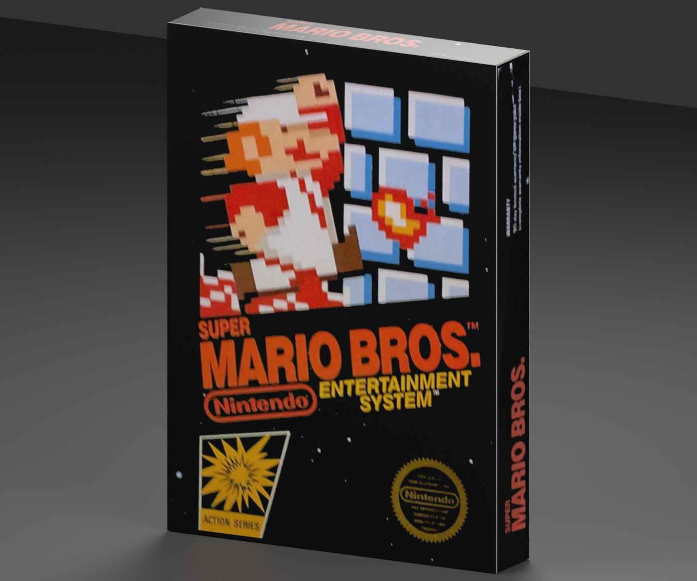
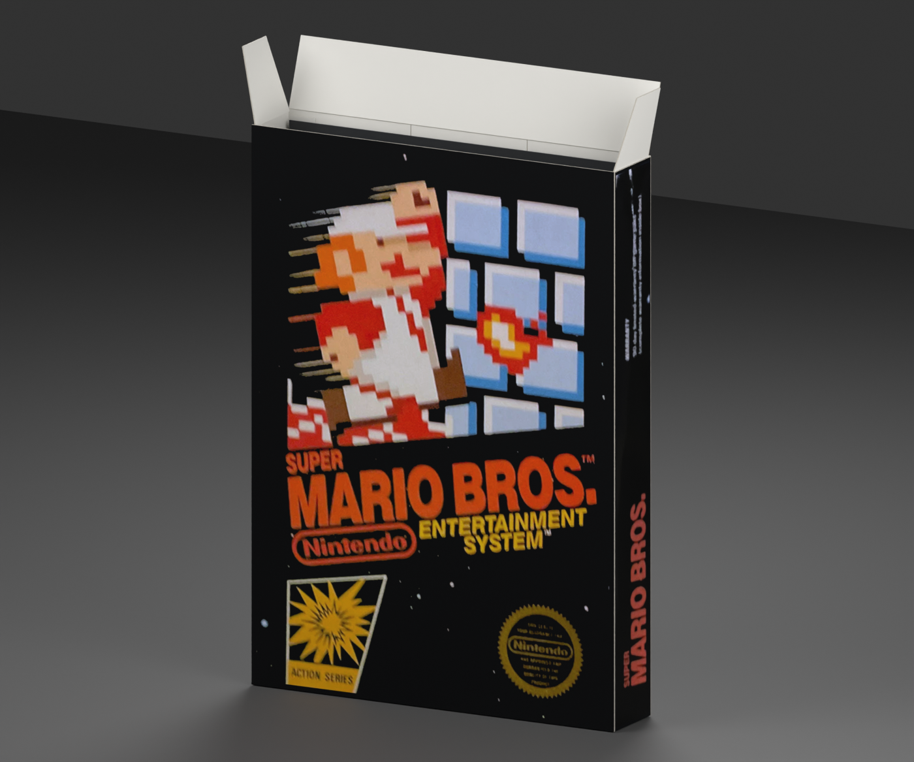

# NES — Super Mario Bros. box reproduction

**Version:** 0.1.0 · **Date:** 2026-10-16 · **Creator:** Lincoln Aleixo

A pristine early Super Mario Bros. carton with its printed outer panels, articulated tuck lid and dust ears, empty black sleeve and foam spacer.

## Edition and contents

Selected edition: **Early US black-box edition with an integrated rear hanger**. This reproduction uses the independently released [nes neutral box template](https://github.com/lincolnaleixo/retro-cartridge-models/tree/main/assets/templates/nes/box), with the same packaging geometry, hinge hierarchy, normalized print UVs and opening animation. Cartridge and CD models remain separate assets; no game media is enclosed. Printed booklet covers, where present, surround approximate blank interior leaves rather than a complete reproduced manual.

The shell and print aim for a pristine, newly unboxed appearance. Original scan pixels; perspective rectification, bounded tonal normalization, border repair and explicitly masked local inpainting. No generated art or typography. Upsampling does not restore absent print detail. Photograph lighting is estimated; colors are not a calibrated match to the physical ink. See per-face effective resolution. All six face layouts verified. Original front is approximately 590×840 effective pixels; thin edges are optically soft. Source photographs have warm lighting and wear. Black-field repair is local; no new glyphs, stars or character art are drawn. Clean Nintendo/MarioWiki REV-A front was rejected because it does not match the requested early box. Restoration is a visual approximation rather than proof of original ink values, manufacturing tolerances or missing lettering. Upsampling does not add authentic detail. Paper texture, scan blur and small source imperfections may remain visible at close range.

## Prepared artwork

| Artwork slot | Approximate effective source pixels | Prepared image pixels | Release file |
| --- | --- | --- | --- |
| `Front` | 591 × 843 | 1437 × 2048 | `artwork/Front.png` in release ZIP |
| `Back` | 1532 × 2100 | 1437 × 2048 | `artwork/Back.png` in release ZIP |
| `SpineLeft` | 1088 × 121 | 403 × 2048 | `artwork/SpineLeft.png` in release ZIP |
| `SpineRight` | 1036 × 118 | 403 × 2048 | `artwork/SpineRight.png` in release ZIP |
| `Top` | 1123 × 161 | 1437 × 403 | `artwork/Top.png` in release ZIP |
| `Bottom` | 794 × 90 | 1437 × 403 | `artwork/Bottom.png` in release ZIP |

Every listed PNG is embedded byte-for-byte in its GLB artwork slot and included separately in the release for reproducible application. The package contains the used prepared faces, their source citations and transformation provenance; it does not include unused research photographs or raw specimen images. Separate files do not grant additional rights to the artwork.

## Import and validation

| Property | Value |
| --- | --- |
| Units and axes | Meters; X width, Y up, +Z front |
| Pivot | Bottom center of the nominal closed envelope |
| Nominal closed size | 128 × 179 × 24 mm |
| Initial pose | Closed |
| Animation | `Open`, 0 to 2 seconds |

The self-contained GLB passed structural, image, UV, hierarchy and animation checks. Direct comparison with its neutral template verified identical positions, normals, artwork UVs, triangle indices, node transforms and animation keys. Godot 4.7.2-stable (official) imported and evaluated both animation endpoints; Blender 5.2.2 LTS reopened the packed editable source and checked both poses. Release reports bind these checks to exact binary hashes.

Dimensions, die cuts, foam size and paper gauge are inferred. The early hanger is a selected US variant, not a claim about every NES printing. Foam pore shading is procedural in the source; the portable export retains its clean base material. Transparent materials and printed-paper highlights can vary between renderers. Godot does not honor the exported specular extension; apply a printed-material specular level of 0.18 when matching the Blender preview lighting.

The release includes editable `.blend`, portable `.glb`, six previews, construction and reference evidence, prepared PNGs, provenance and validation reports. Run the repository's `tools/create_game_boxes.py` from the unpacked release directory, passing `--console nes --asset-id nes-super-mario-bros-box --artwork artwork-mapping.json --output regenerated`, to rebuild with the included artwork mapping.

See [credits](CREDITS.md) and [changelog](CHANGELOG.md). Original modeling contributions only: CC BY-NC-ND 4.0. Game artwork, marks, product designs, scans and source photography are excluded. Attribution and the maintainer's request do not grant rights to those elements.
