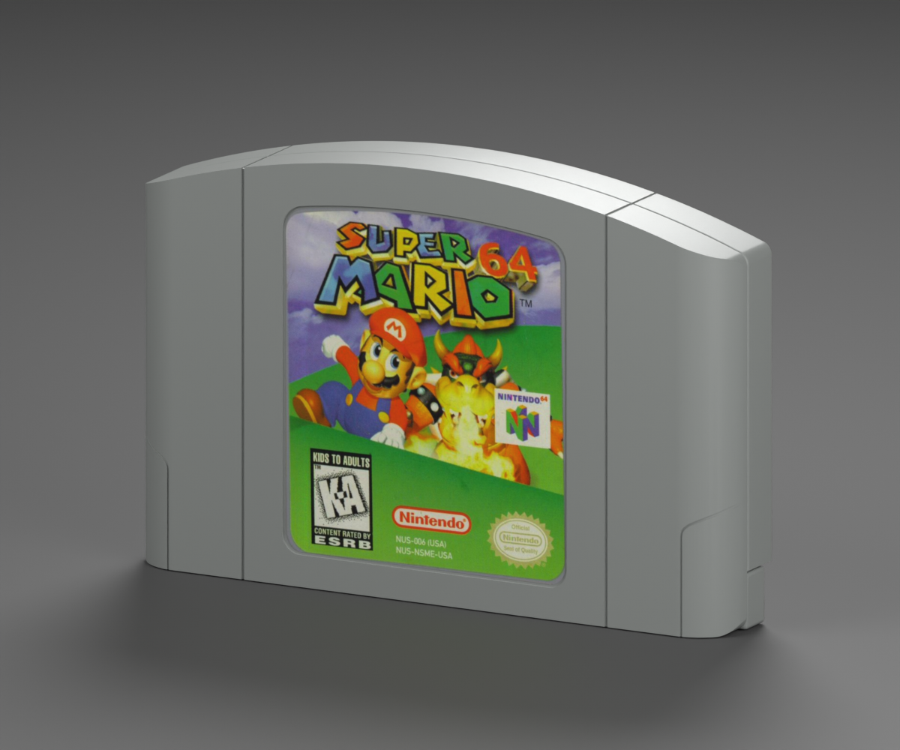

# Nintendo 64 — Super Mario 64 reproduction

**Version:** 0.3.0 · **Date:** 2026-10-16 · **Reconstruction:** Lincoln Aleixo

[Explore in 3D](https://lincolnaleixo.github.io/retro-cartridge-models/#nintendo-64-super-mario-64) · [Download release](https://github.com/lincolnaleixo/retro-cartridge-models/releases/tag/nintendo-64-super-mario-64-v0.3.0) · [Previous release](https://github.com/lincolnaleixo/retro-cartridge-models/releases/tag/nintendo-64-super-mario-64-v0.2.0) · [Changelog](CHANGELOG.md)

Pristine K-A front and 1996 rear labels on the refined North American Game Pak. Original character art is locally retouched; the rear warning print is restored without changing the shell or UVs.

The front uses localized inpainting and a 2.5% saturation/contrast adjustment. The rear uses built-in image generation followed by measured image registration. Warning wording, MANUAL spelling, 1996 copyright and edition codes were visually checked.

Nominal dimensions: 116 × 76.6 × 18.5 mm. The published shell, vertex/index data, normals, transforms, material definitions and every mesh UV byte are preserved. Only the selected packed artwork images change. Units remain meters, Y is up and +Z is front; the existing pivot and label surfaces remain compatible. This is a visualization reconstruction, not manufacturing CAD.

The package contains editable packed Blender source, a self-contained GLB, five actual-export views, attribution and restoration/validation records. Blender and Godot compare the previous and restored geometry directly. New and previous exports were rendered under the same neutral studio, Standard view transform, exposure -1.0, 32 Cycles samples and 1200 × 1000 output. Historical previews remain unchanged; the new matched renders isolate the artwork changes.

The target is clean, newly unboxed print. Original edition marks and illustration are preserved; colors and restored fine lettering are approximate, not color-calibrated factory masters. Third-party artwork, marks, product design and photography are excluded from CC BY-NC-ND 4.0, which applies only to original modeling contributions. The maintainer request does not grant those third-party rights. See [credits](CREDITS.md), [changes](CHANGELOG.md) and [NOTICE.md](../../../../NOTICE.md).
