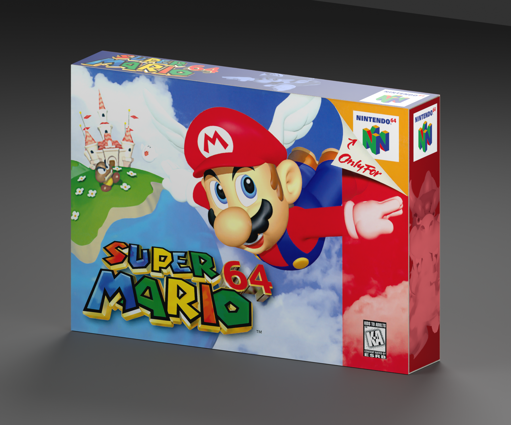

# Nintendo 64 — Super Mario 64 box reproduction

**Version:** 0.3.0 · **Date:** 2026-10-16 · **Creator:** Lincoln Aleixo

A pristine original-edition Super Mario 64 carton with printed panels, articulated end closures and the matching Game Pak in its removable folded cradle.

## Edition and contents

Selected edition: **Original US K-A retail presentation**. This reproduction uses the independently released [nintendo-64 neutral box template v0.1.0](https://github.com/lincolnaleixo/retro-cartridge-models/releases/tag/nintendo-64-box-v0.1.0), with the same packaging geometry, hinge hierarchy, normalized print UVs and opening animation. The matching [nintendo-64-super-mario-64 v0.3.0](https://github.com/lincolnaleixo/retro-cartridge-models/releases/download/nintendo-64-super-mario-64-v0.3.0/nintendo-64-super-mario-64-0.3.0.zip) is enclosed at its original scale beneath a removable `Contents` parent. Its published geometry, materials and embedded artwork are preserved exactly; its pinned manifest, original credits and provenance are included in `content-source/`. The standalone cartridge/disc release remains unchanged. Contact positions are approximate rigid visualizations; flexible paper and plastic deformation are not simulated. Printed booklet covers, where present, surround approximate blank interior leaves rather than a complete reproduced manual.

The normal `Open` pose keeps the sleeve/tray seated inside the carton. The release also includes `inspection-views/contents.png`, showing the original insert and cartridge moved out together for inspection. This documented inspection pose does not change the exported default pose or animation.

The shell and print aim for a pristine, newly unboxed appearance. Deterministic print reconstruction: selectively remove halftone grain, rebuild flat fields and exact transcribed text, preserve original illustration contours and gameplay scenes. No generative imagery. Digital reconstruction, not an untouched original scan. Colors and replacement typefaces are visual approximations, not calibrated factory inks. Original gameplay screenshots retain their source-resolution limit. The quality seal and recycling symbol are documented geometric reconstructions of the original marks. Duotone edge illustrations are source-based reconstructions with approximate placement and ink colors, not newly discovered flat original scans. Nintendo Classics front source remains 1548 × 1080 pixels; original rear comes from the 4170 × 2916 scan. Small jump illustration is 330 × 330 pixels; enlargement cannot add source detail. Replacement typography, seal/recycle geometry and warm background repairs are visual approximations, not calibrated factory print. Restoration is a visual approximation rather than proof of original ink values, manufacturing tolerances or missing lettering. Upsampling does not add authentic detail. Paper texture, scan blur and small source imperfections may remain visible at close range.

## Prepared artwork

| Artwork slot | Approximate effective source pixels | Prepared image pixels | Release file |
| --- | --- | --- | --- |
| `Front` | See per-face provenance | 4096 × 2874 | `artwork/Front.png` in release ZIP |
| `Back` | See per-face provenance | 4096 × 2874 | `artwork/Back.png` in release ZIP |
| `Top` | See per-face provenance | 4096 × 806 | `artwork/Top.png` in release ZIP |
| `Bottom` | See per-face provenance | 4096 × 806 | `artwork/Bottom.png` in release ZIP |
| `SpineLeft` | See per-face provenance | 834 × 2952 | `artwork/SpineLeft.png` in release ZIP |
| `SpineRight` | See per-face provenance | 834 × 2952 | `artwork/SpineRight.png` in release ZIP |

Every listed PNG is embedded byte-for-byte in its GLB artwork slot and included separately in the release for reproducible application. The package contains the used prepared faces, their source citations and transformation provenance; it does not include unused research photographs or raw specimen images. Separate files do not grant additional rights to the artwork.

## Import and validation

| Property | Value |
| --- | --- |
| Units and axes | Meters; X width, Y up, +Z front |
| Pivot | Bottom center of the nominal closed envelope |
| Nominal closed size | 179 × 128 × 31 mm |
| Initial pose | Closed |
| Animation | `Open`, 0 to 2 seconds |

The self-contained GLB passed structural, image, UV, hierarchy and animation checks. Direct comparison of its box subset with the neutral template verified identical positions, normals, artwork UVs, triangle indices, node transforms and animation keys. The added contents are checked separately against their pinned source release. Godot 4.7.2-stable (official) imported and evaluated both animation endpoints; Blender 5.2.2 LTS reopened the packed editable source and checked both poses. Release reports bind these checks to exact binary hashes.

Protector-fit dimensions establish an approximate envelope. The tray construction is informed by original and replacement examples; its die line and board thickness are not asserted to match a specific Nintendo factory revision. Transparent materials and printed-paper highlights can vary between renderers. Godot does not honor the exported specular extension; apply a printed-material specular level of 0.18 when matching the Blender preview lighting.

The release includes editable `.blend`, portable `.glb`, six previews, construction and reference evidence, prepared PNGs, provenance and validation reports. The editable source supports moving or removing `Contents`. Re-exporting through a DCC tool may alter buffer precision. To preserve the original media bytes, use the repository's `tools/compose_box_contents.py` with a print-only box source and the pinned media release. See `content-composition.json` for exact source hashes, parent, placement and preservation checks, and the repository's restoration documentation for the rebuild workflow.

See [credits](CREDITS.md) and [changelog](CHANGELOG.md). Original modeling contributions only: CC BY-NC-ND 4.0. Game artwork, marks, product designs, scans and source photography are excluded. Attribution and the maintainer's request do not grant rights to those elements.
