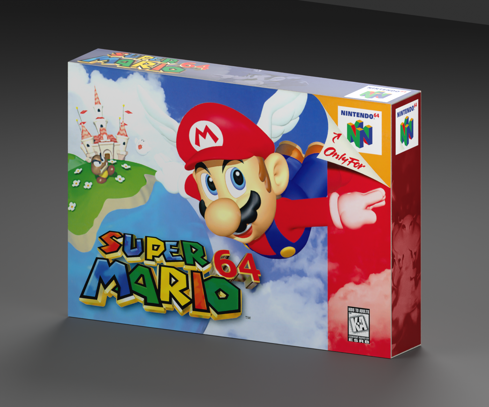
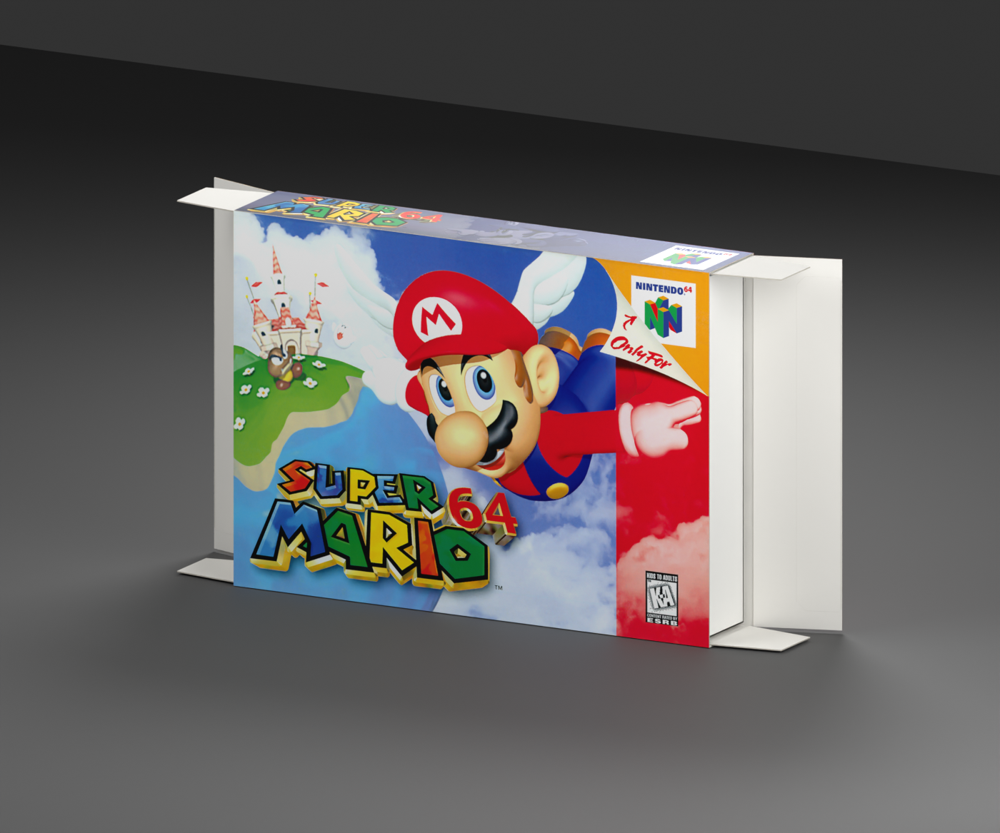

# Nintendo 64 — Super Mario 64 box reproduction

**Version:** 0.2.0 · **Date:** 2026-10-16 · **Creator:** Lincoln Aleixo

A pristine original-edition Super Mario 64 carton with printed panels, articulated end closures and a removable folded Game Pak cradle.

## Edition and contents

Selected edition: **Original US K-A retail presentation**. This reproduction uses the independently released [nintendo-64 neutral box template v0.1.0](https://github.com/lincolnaleixo/retro-cartridge-models/releases/tag/nintendo-64-box-v0.1.0), with the same packaging geometry, hinge hierarchy, normalized print UVs and opening animation. Cartridge and CD models remain separate assets; no game media is enclosed. Printed booklet covers, where present, surround approximate blank interior leaves rather than a complete reproduced manual.

The shell and print aim for a pristine, newly unboxed appearance. Pristine print restoration using original Nintendo artwork, source scans, deterministic descreening and explicitly bounded compositing. Photographic colors and reconstructed empty edge fields are approximations, not calibrated factory inks. No new game illustration was generated. Small original character details retain source-resolution limits. Original US K-A front uses clean 1548 × 1080 Nintendo artwork; rear uses the 4170 × 2916 original scan prepared at 3072 × 2155. Narrow panels preserve the photographed duotone character art, with exposure and scan-noise correction and clean original title/console marks. Empty fields behind logos are reconstructed approximations; small character details remain limited by the source photograph. Color normalization is visual, not a calibrated match to physical factory inks. Restoration is a visual approximation rather than proof of original ink values, manufacturing tolerances or missing lettering. Upsampling does not add authentic detail. Paper texture, scan blur and small source imperfections may remain visible at close range.

## Prepared artwork

| Artwork slot | Approximate effective source pixels | Prepared image pixels | Release file |
| --- | --- | --- | --- |
| `Front` | 1548 × 1080 | 2048 × 1437 | `artwork/Front.png` in release ZIP |
| `Back` | 4170 × 2916 | 3072 × 2155 | `artwork/Back.png` in release ZIP |
| `SpineLeft` | 1476 × 367 | 417 × 1476 | `artwork/SpineLeft.png` in release ZIP |
| `SpineRight` | 1504 × 285 | 417 × 1476 | `artwork/SpineRight.png` in release ZIP |
| `Top` | 1806 × 220 | 2048 × 403 | `artwork/Top.png` in release ZIP |
| `Bottom` | 1726 × 200 | 2048 × 403 | `artwork/Bottom.png` in release ZIP |

Every listed PNG is embedded byte-for-byte in its GLB artwork slot and included separately in the release for reproducible application. The package contains the used prepared faces, their source citations and transformation provenance; it does not include unused research photographs or raw specimen images. Separate files do not grant additional rights to the artwork.

## Import and validation

| Property | Value |
| --- | --- |
| Units and axes | Meters; X width, Y up, +Z front |
| Pivot | Bottom center of the nominal closed envelope |
| Nominal closed size | 179 × 128 × 31 mm |
| Initial pose | Closed |
| Animation | `Open`, 0 to 2 seconds |

The self-contained GLB passed structural, image, UV, hierarchy and animation checks. Direct comparison with its neutral template verified identical positions, normals, artwork UVs, triangle indices, node transforms and animation keys. Godot 4.7.2-stable (official) imported and evaluated both animation endpoints; Blender 5.2.2 LTS reopened the packed editable source and checked both poses. Release reports bind these checks to exact binary hashes.

Protector-fit dimensions establish an approximate envelope. The tray construction is informed by original and replacement examples; its die line and board thickness are not asserted to match a specific Nintendo factory revision. Transparent materials and printed-paper highlights can vary between renderers. Godot does not honor the exported specular extension; apply a printed-material specular level of 0.18 when matching the Blender preview lighting.

The release includes editable `.blend`, portable `.glb`, six previews, construction and reference evidence, prepared PNGs, provenance and validation reports. Run the repository's `tools/create_game_boxes.py` from the unpacked release directory, passing `--console nintendo-64 --asset-id nintendo-64-super-mario-64-box --source nintendo-64-super-mario-64-box.blend --artwork artwork-mapping.json --output regenerated`, to rebuild with the included artwork mapping while preserving the published source geometry.

See [credits](CREDITS.md) and [changelog](CHANGELOG.md). Original modeling contributions only: CC BY-NC-ND 4.0. Game artwork, marks, product designs, scans and source photography are excluded. Attribution and the maintainer's request do not grant rights to those elements.
