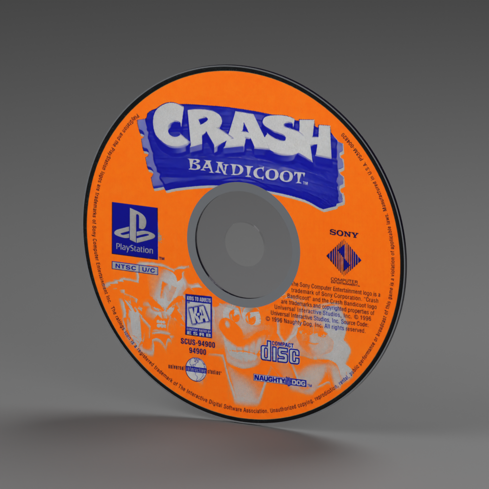

# PlayStation 1 — Crash Bandicoot disc example

**Version:** 0.1.0 · **Reconstruction:** Lincoln Aleixo

[Explore in 3D](https://lincolnaleixo.github.io/retro-cartridge-models/#playstation-1-crash-bandicoot) · [Download release](https://github.com/lincolnaleixo/retro-cartridge-models/releases/tag/playstation-1-crash-bandicoot-v0.1.0) · [Changelog](CHANGELOG.md)

The standalone Crash Bandicoot (1996), SCUS-94900 PlayStation CD. It has a true center hole, clear hub, narrow matrix and rim, and a dark reading face. No case is included.

The scan's pink cast was approximately restored with imagegen using a photograph of the physical disc as a color reference. The print now has an orange field, blue-violet ink and neutral gray silver areas. This is an AI-assisted visual restoration: fine lettering may differ from the original scan, and the colors are not a calibrated reproduction. Silver areas use gray albedo; this version has no per-pixel metallic mask.

The package includes packed editable Blender source, a self-contained GLB, previews and provenance. The unchanged neutral-disc geometry measures nominally 120 × 120 × 1.2 mm with a 15 mm hole. Units are meters, X is width, Y is up and +Z is front, with a bottom-center pivot. The annular front mesh clips the artwork around the rim and hub.

The printed surface uses sRGB artwork, roughness 0.68 and reduced dielectric specular reflection. Previews use neutral lighting. Godot 4.7.2 consumers should compensate the imported label's specular value as described in [owner artwork](../../../../docs/owner-artwork.md), while preserving the optical hub, matrix and rim materials.

This separately versioned example leaves `playstation-1` 0.1.0 unchanged. Publish and verify the model package before updating a consuming application.

Original reconstruction contributions are CC BY-NC-ND 4.0. Crash Bandicoot artwork, PlayStation and other third-party marks, scans and photographs are excluded from that grant. This is an independent example; no affiliation or third-party license is implied. See [credits](CREDITS.md) and the root [NOTICE.md](../../../../NOTICE.md).
