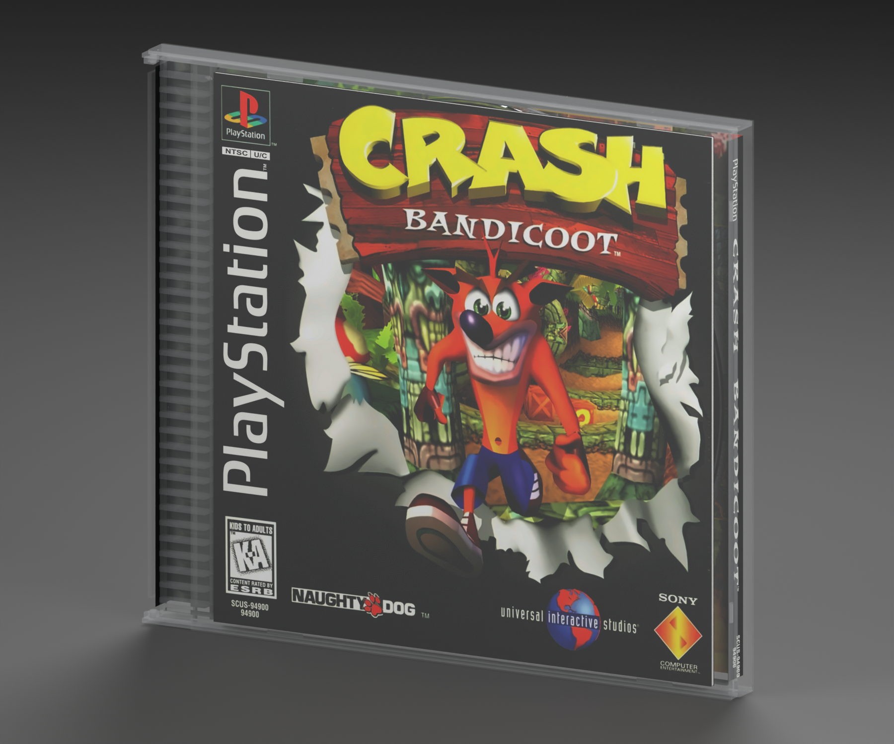
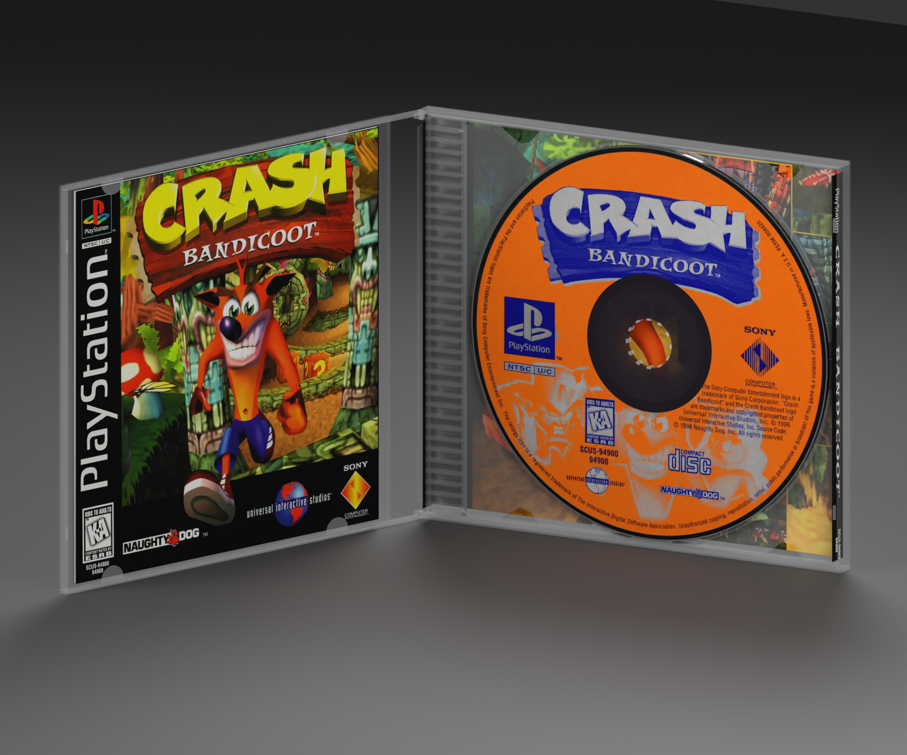

# PlayStation 1 — Crash Bandicoot box reproduction

**Version:** 0.4.0 · **Date:** 2026-10-16 · **Creator:** Lincoln Aleixo

A clean Crash Bandicoot clear-tray jewel case with original-edition paper inserts, articulated lid and the matching removable disc on the hub.

## Edition and contents

Selected edition: **Original US black-label SCUS-94900 presentation**. This reproduction uses the independently released [playstation-1 neutral box template v0.3.0](https://github.com/lincolnaleixo/retro-cartridge-models/releases/tag/playstation-1-box-v0.3.0), with the same packaging geometry, hinge hierarchy, normalized print UVs and opening animation. The matching [playstation-1-crash-bandicoot v0.2.0](https://github.com/lincolnaleixo/retro-cartridge-models/releases/download/playstation-1-crash-bandicoot-v0.2.0/playstation-1-crash-bandicoot-0.2.0.zip) is enclosed at its original scale beneath a removable `Contents` parent. Its published geometry, materials and embedded artwork are preserved exactly; its pinned manifest, original credits and provenance are included in `content-source/`. The standalone cartridge/disc release remains unchanged. Contact positions are approximate rigid visualizations; flexible paper and plastic deformation are not simulated. Printed booklet covers, where present, surround approximate blank interior leaves rather than a complete reproduced manual.

The package includes both side profiles and an open disc-hub close-up in `inspection-views/`, rendered from this exact export.

The shell and print aim for a pristine, newly unboxed appearance. Deterministic original-print noise reduction, matching classic vector branding, and bounded single-ink contour restoration. The original four-part SCUS-94900 K-A print set and all game illustrations are retained. The matching classic 1994 wordmark replaces only worn branding. NTSC U/C and TM text is reproduced exactly, using a documented approximate Arial Bold face rather than a verified original production font. Enlargement supplies antialiased lettering but does not recover new photographic detail. Original game screenshot detail remains source-limited. Sony official timeline artwork was researched but rejected as a 400×400 jewel-case product image with lower effective cover detail. Modern PlayStation wordmarks were rejected because their letter shapes differ. The original four-part SCUS-94900 K-A set and all game illustrations remain. Matching classic 1994 wordmarks replace only worn console branding. NTSC U/C and TM copy is reproduced exactly using approximate Arial Bold, not a verified original production font. Original rear copy and screenshot detail remain source-limited; output enlargement does not recover new photographic detail. Printed inner ribbed design remains artwork; only unprinted outside trim loses crease glare. Colors are visual estimates. Restoration is a visual approximation rather than proof of original ink values, manufacturing tolerances or missing lettering. Upsampling does not add authentic detail. Paper texture, scan blur and small source imperfections may remain visible at close range.

## Prepared artwork

| Artwork slot | Approximate effective source pixels | Prepared image pixels | Release file |
| --- | --- | --- | --- |
| `Front` | See per-face provenance | 2850 × 2802 | `artwork/Front.png` in release ZIP |
| `WrapBack` | See per-face provenance | 3536 × 2736 | `artwork/WrapBack.png` in release ZIP |
| `BookletBack` | See per-face provenance | 2834 × 2808 | `artwork/BookletBack.png` in release ZIP |
| `WrapInside` | See per-face provenance | 3510 × 2760 | `artwork/WrapInside.png` in release ZIP |

Every listed PNG is embedded byte-for-byte in its GLB artwork slot and included separately in the release for reproducible application. The package contains the used prepared faces, their source citations and transformation provenance; it does not include unused research photographs or raw specimen images. Separate files do not grant additional rights to the artwork.

## Import and validation

| Property | Value |
| --- | --- |
| Units and axes | Meters; X width, Y up, +Z front |
| Pivot | Bottom center of the nominal closed envelope |
| Nominal closed size | 142.35 × 124.75 × 10.4 mm |
| Initial pose | Closed |
| Animation | `Open`, 0 to 2 seconds |

The self-contained GLB passed structural, image, UV, hierarchy and animation checks. Direct comparison of its box subset with the neutral template verified identical positions, normals, artwork UVs, triangle indices, node transforms and animation keys. The exporter rounded 40 non-artwork UV scalars by at most 5.96e-08; this is recorded separately and does not change any printed-face UV coordinates. The added contents are checked separately against their pinned source release. Godot 4.7.2-stable (official) imported and evaluated both animation endpoints; Blender 5.2.2 LTS reopened the packed editable source and checked both poses. Release reports bind these checks to exact binary hashes.

The envelope uses midpoint values from CMC assembly inspection ranges, not proof of the original Sony supplier. Fine molded features, booklet leaves and paper-fit dimensions are approximate. Clear plastic rendering depends on the importing engine. Transparent materials and printed-paper highlights can vary between renderers. Godot does not honor the exported specular extension; apply a printed-material specular level of 0.18 when matching the Blender preview lighting.

The release includes editable `.blend`, portable `.glb`, six previews, construction and reference evidence, prepared PNGs, provenance and validation reports. The editable source supports moving or removing `Contents`. Re-exporting through a DCC tool may alter buffer precision. To preserve the original media bytes, use the repository's `tools/compose_box_contents.py` with a print-only box source and the pinned media release. See `content-composition.json` for exact source hashes, parent, placement and preservation checks, and the repository's restoration documentation for the rebuild workflow.

See [credits](CREDITS.md) and [changelog](CHANGELOG.md). Original modeling contributions only: CC BY-NC-ND 4.0. Game artwork, marks, product designs, scans and source photography are excluded. Attribution and the maintainer's request do not grant rights to those elements.
