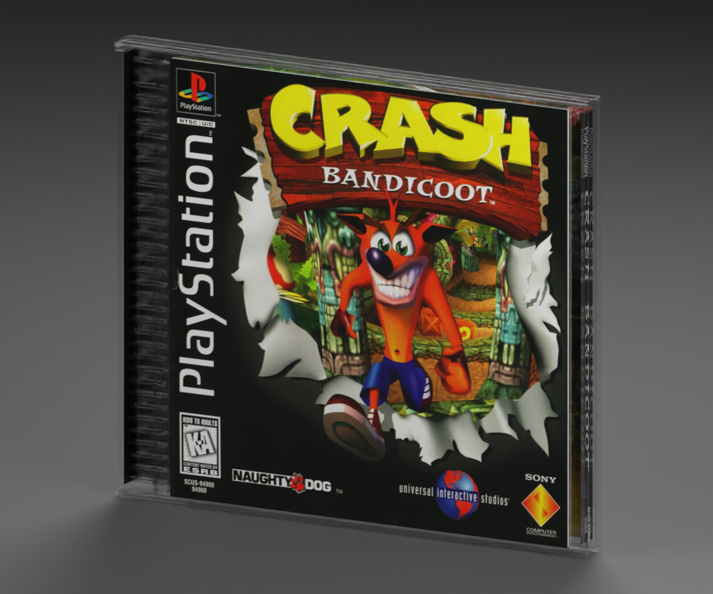
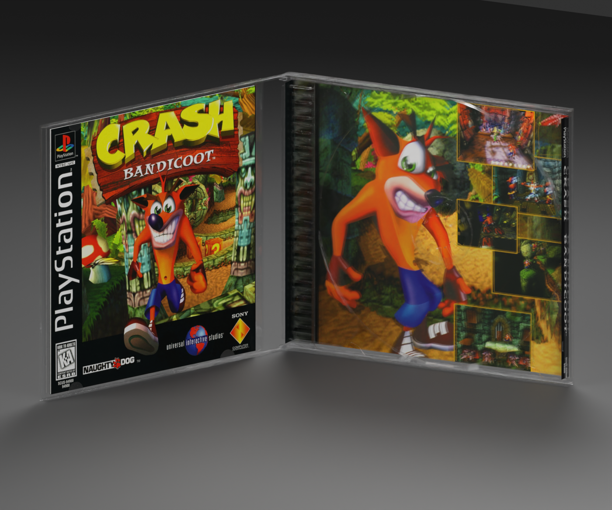

# PlayStation 1 — Crash Bandicoot box reproduction

**Version:** 0.2.0 · **Date:** 2026-10-16 · **Creator:** Lincoln Aleixo

A clean Crash Bandicoot clear-tray jewel case with original-edition booklet covers, both sides of the folded tray card and an articulated lid.

## Edition and contents

Selected edition: **Original US black-label SCUS-94900 presentation**. This reproduction uses the independently released [playstation-1 neutral box template v0.2.0](https://github.com/lincolnaleixo/retro-cartridge-models/releases/tag/playstation-1-box-v0.2.0), with the same packaging geometry, hinge hierarchy, normalized print UVs and opening animation. Cartridge and CD models remain separate assets; no game media is enclosed. Printed booklet covers, where present, surround approximate blank interior leaves rather than a complete reproduced manual.

The shell and print aim for a pristine, newly unboxed appearance. Deterministic local scan descreen and documented face-specific pristine reconstruction. No scan detail is invented. Colors are estimated from uncalibrated references. NES original illustration and small photographed console wordmark remain optically softer than reconstructed edges. Complete four-part original SCUS-94900 print set, including both exterior rear spines. Separate luminance/chroma descreen reduces coarse scan grain; fine rear type uses a gentler kernel. Known plain-black spine and trim fields are restored while original artwork remains; scans are not color-calibrated print proofs. Clear tray is verified by the documented physical US specimen. Updated neutral-template clear-plastic alpha fallback preserves readability in Godot Compatibility while making molded edges visible; exact reflections vary by renderer. Restoration is a visual approximation rather than proof of original ink values, manufacturing tolerances or missing lettering. Upsampling does not add authentic detail. Paper texture, scan blur and small source imperfections may remain visible at close range.

## Prepared artwork

| Artwork slot | Approximate effective source pixels | Prepared image pixels | Release file |
| --- | --- | --- | --- |
| `Front` | See per-face provenance | 1425 × 1401 | `artwork/Front.png` in release ZIP |
| `WrapBack` | See per-face provenance | 1768 × 1368 | `artwork/WrapBack.png` in release ZIP |
| `BookletBack` | See per-face provenance | 1417 × 1404 | `artwork/BookletBack.png` in release ZIP |
| `WrapInside` | See per-face provenance | 1755 × 1380 | `artwork/WrapInside.png` in release ZIP |

Every listed PNG is embedded byte-for-byte in its GLB artwork slot and included separately in the release for reproducible application. The package contains the used prepared faces, their source citations and transformation provenance; it does not include unused research photographs or raw specimen images. Separate files do not grant additional rights to the artwork.

## Import and validation

| Property | Value |
| --- | --- |
| Units and axes | Meters; X width, Y up, +Z front |
| Pivot | Bottom center of the nominal closed envelope |
| Nominal closed size | 142.35 × 124.75 × 10.4 mm |
| Initial pose | Closed |
| Animation | `Open`, 0 to 2 seconds |

The self-contained GLB passed structural, image, UV, hierarchy and animation checks. Direct comparison with its neutral template verified identical positions, normals, artwork UVs, triangle indices, node transforms and animation keys. The exporter rounded 32 non-artwork UV scalars by at most 5.96e-08; this is recorded separately and does not change any printed-face UV coordinates. Godot 4.7.2-stable (official) imported and evaluated both animation endpoints; Blender 5.2.2 LTS reopened the packed editable source and checked both poses. Release reports bind these checks to exact binary hashes.

The envelope uses midpoint values from CMC assembly inspection ranges, not proof of the original Sony supplier. Fine molded features, booklet leaves and paper-fit dimensions are approximate. Clear plastic rendering depends on the importing engine. Transparent materials and printed-paper highlights can vary between renderers. Godot does not honor the exported specular extension; apply a printed-material specular level of 0.18 when matching the Blender preview lighting.

The release includes editable `.blend`, portable `.glb`, six previews, construction and reference evidence, prepared PNGs, provenance and validation reports. Run the repository's `tools/create_game_boxes.py` from the unpacked release directory, passing `--console playstation-1 --asset-id playstation-1-crash-bandicoot-box --source playstation-1-crash-bandicoot-box.blend --artwork artwork-mapping.json --output regenerated`, to rebuild with the included artwork mapping while preserving the published source geometry.

See [credits](CREDITS.md) and [changelog](CHANGELOG.md). Original modeling contributions only: CC BY-NC-ND 4.0. Game artwork, marks, product designs, scans and source photography are excluded. Attribution and the maintainer's request do not grant rights to those elements.
