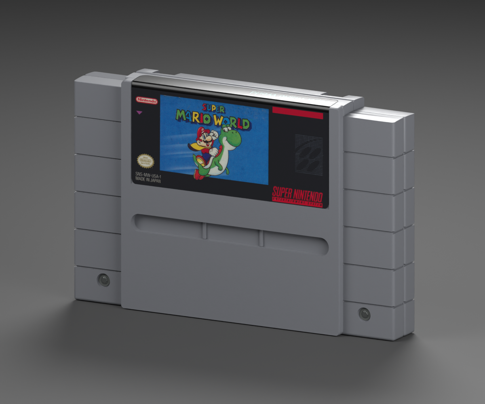

# SNES — Super Mario World example

**Version:** 0.2.0 · **Date:** 2026-10-16 · **Reconstruction:** Lincoln Aleixo

[Explore in 3D](https://lincolnaleixo.github.io/retro-cartridge-models/#snes-super-mario-world) · [Download release](https://github.com/lincolnaleixo/retro-cartridge-models/releases/tag/snes-super-mario-world-v0.2.0) · [Previous release](https://github.com/lincolnaleixo/retro-cartridge-models/releases/tag/snes-super-mario-world-v0.1.1) · [Changelog](CHANGELOG.md)

Super Mario World with repaired blue-field scan blemishes and cleaner print color, preserving original illustration, halftone, folded top, rear warning label and shared neutral-shell label exports.

Local processing uses masked cloning from a clean blue part of the original print to retain halftone texture, one thin scratch repair and a 4% panel color/contrast adjustment. No character art or typography is regenerated.

Nominal dimensions: 135.4 × 88 × 19.9 mm. The published shell, vertex/index data, normals, transforms, material definitions and every mesh UV byte are preserved. Only the selected packed artwork images change. Units remain meters, Y is up and +Z is front; the existing pivot and label surfaces remain compatible. This is a visualization reconstruction, not manufacturing CAD.

The package contains editable packed Blender source, a self-contained GLB, five actual-export views, attribution and restoration/validation records. Blender and Godot compare the previous and restored geometry directly. New and previous exports were rendered under the same neutral studio, Standard view transform, exposure -1.0, 32 Cycles samples and 1200 × 1000 output. Historical previews remain unchanged; the new matched renders isolate the artwork changes.

`labels/front.png` matches the restored embedded front image exactly. `labels/rear.png` is unchanged from 0.1.1. Consumers can update the pinned front label while continuing to use the same neutral shell.

The target is clean, newly unboxed print. Original edition marks and illustration are preserved; colors and restored fine lettering are approximate, not color-calibrated factory masters. Third-party artwork, marks, product design and photography are excluded from CC BY-NC-ND 4.0, which applies only to original modeling contributions. The maintainer request does not grant those third-party rights. See [credits](CREDITS.md), [changes](CHANGELOG.md) and [NOTICE.md](../../../../NOTICE.md).
