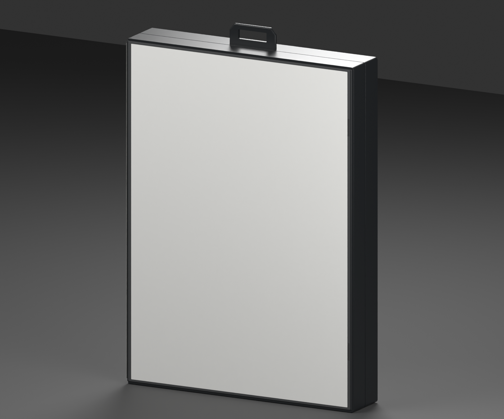
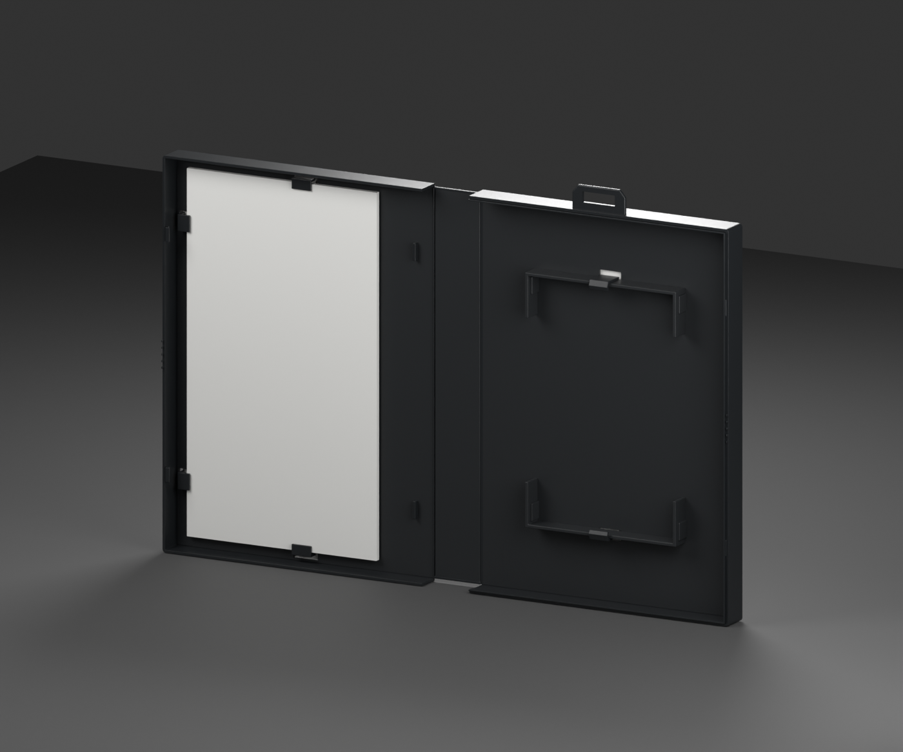

# Mega Drive — western clamshell box template

**Version:** 0.2.0 · **Date:** 2026-10-16 · **Creator:** Lincoln Aleixo

A fresh black clamshell with two spine folds, transparent cover sleeve, sideways cartridge guides, booklet retainers and an intact retail hanger.

The spine UV contract is corrected in this release: viewed from outside the left edge (-X) with +Y up, U increases from the rear edge (-Z) to the front edge (+Z). The previous release mirrored spine print. Only `SpinePrint` U coordinates changed; the mesh, V coordinates, other print targets and opening animation are preserved.

Export also rounded 29 unprinted UV scalars by at most two representable float32 steps. The exact migration and rounding are recorded in `glb-inspection.json`.






- Hollow black molded front and rear shells with two separate spine pivots and a 180-degree open spread.
- Independent clear cover sleeve above the unprinted front, spine and rear paper surfaces.
- Opposing sideways cartridge guides with spring tongues, booklet retainers, snap details and tooling witness marks.
- The intact retail hanger is a named separate part. A neutral booklet placeholder and cartridge placement anchor remain editable.

## Import contract

| Property | Value |
| --- | --- |
| Units and axes | Meters; X width, Y up, +Z front |
| Pivot | Bottom center of the nominal closed envelope |
| Nominal closed size | 129 × 188 × 26 mm |
| Initial pose | Closed |
| Animation | `Open`, 0 to 2 seconds |
| Game media | None; cartridge/CD assets are separate |

The editable source preserves separate packaging parts. The portable GLB keeps named artwork surfaces, hinge nodes and removable-insert anchors. Artwork is confined to exterior or explicitly designated paper faces; inner carton stock remains unprinted. These are pristine materials without simulated wear, stains or yellowing.

### Artwork targets

| Named surface | Artwork slot |
| --- | --- |
| `BackPrint` | `Back` |
| `BookletBackPrint` | `BookletBack` |
| `BookletFrontPrint` | `BookletFront` |
| `FrontPrint` | `Front` |
| `SpinePrint` | `Spine` |

Slots use normalized UV coordinates with upright exterior print orientation. A slot may span several named pieces; those pieces share a continuous UV field where a die cut or fold interrupts the paper. The neutral surfaces carry no game artwork.

### Articulation

The `Open` clip preserves a closed frame at 0 seconds and the inspection opening at 2 seconds. Named hinge nodes: `FrontLid`, `RearSpineHinge`. Hinge extras record the axis, endpoint quaternions and opening phase. Paper and flexible plastic are approximated by rigid articulated parts, not a deformation simulation.

## Validation and limitations

The self-contained GLB passed structural geometry, hierarchy, artwork UV, embedded-resource and animation-endpoint checks. Godot 4.7.2-stable (official) imported it and verified both Open endpoints, named parts and artwork surfaces. Blender 5.2.2 LTS reopened the editable source and checked both poses. Exact binary hashes and measured differences are included in the release validation reports.

The 129 × 177 × 26 mm body and 188 mm height including hanger are nominal estimates from protector fit and specimen photographs. Mold revision, clip offsets, sleeve thickness and booklet pagination are approximate. Flexible spine folds use rigid pivots. No manuals with printed content, promotional inserts, shrinkwrap or game media are included. A detached-insert image, where provided, is a separate inspection arrangement; it does not change the default Open clip.

## Generate and review

From the repository root:

```sh
blender -b --python tools/create_game_boxes.py -- --console mega-drive
python3 tools/inspect_game_box.py dist/game-boxes-20261016/templates/mega-drive-box/mega-drive-box.glb
```

The release contains editable `.blend`, portable `.glb`, six standard views, construction metadata, reference evidence, validation reports and license notices. The repository retains versioned preview snapshots and metadata. See [credits](CREDITS.md) and [changelog](CHANGELOG.md).

Original contributions: CC BY-NC-ND 4.0. Product designs and third-party marks are excluded. No game artwork, source photograph or copied logo is included.
