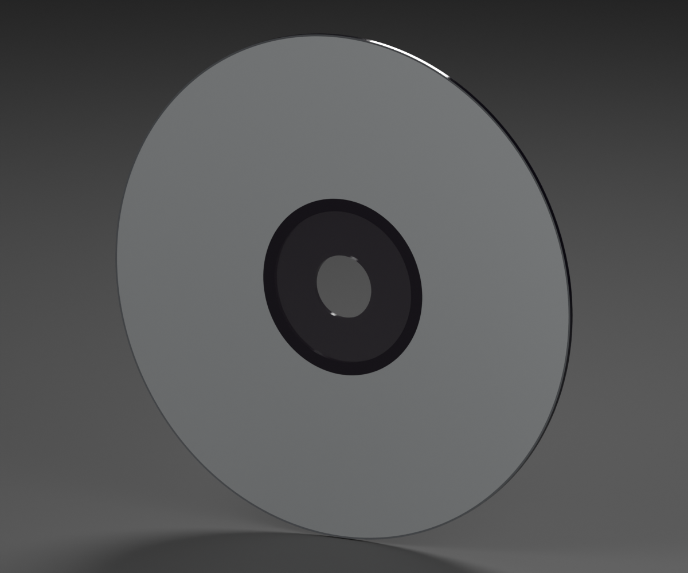

# PlayStation 1 — standalone CD

**Version:** 0.2.0 · **Date:** 2026-10-16 · **Creator:** Lincoln Aleixo

The disc has a distinct 15 mm opening inside a darker smoke-tinted clamping annulus. The bright gray inner band and the hidden surface that caused radial WebGL artifacts are corrected upstream in this standalone asset.

The nominal dimensions remain 120 × 120 × 1.2 mm, with a 15 mm center hole. Units are meters, Y is up, +Z faces the print, and the pivot remains at the bottom center. Positions, normals, UVs, artwork pixels, outer rim and reading-side shading are unchanged; the export omits 512 hidden body-top triangles and uses a dedicated inner-transition material. The five named media meshes and editable packed source remain available.

The package includes six actual-GLB previews, source/preservation receipts, import validation and reference attribution. Godot 4.7.2 compares all remaining imported triangles, normals, UVs, transforms and decoded textures to 0.1.0. The browser check confirms the radial print artifacts are gone. See `disc-material-refinement.json`, `glb-inspection.json`, `godot-import-report.json` and `render-proof.json`.

The smoke tint, opacity and transmission are visual approximations from photographed specimens, not measured optical constants. The current 18 mm material boundary and 21 mm print-mask radius remain unchanged; references establish only an approximately 20 mm dark annulus. Fine concentric molded rings are not reproduced. Independent material submeshes are not manufacturing-solid CAD; the visible front is covered by the existing label, inner transition and outer rim.

Rebuild from the original published source and GLB using Blender: `blender --background --python tools/refine_playstation_disc.py -- --source <original.blend> --model <original.glb> --output <new-folder>`. The tool supports the two specifically audited PS1 disc 0.2.0 upgrades and never rewrites published archives.

Original model contributions are CC BY-NC-ND 4.0. Product designs, trademarks, third-party artwork, scans and photography remain excluded. See [credits](CREDITS.md), [changes](CHANGELOG.md), [NOTICE.md](NOTICE.md) and [LICENSE](LICENSE).
