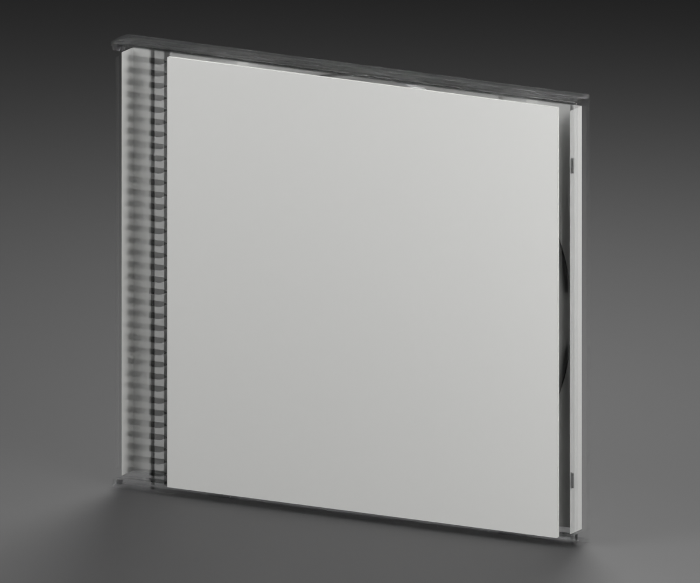
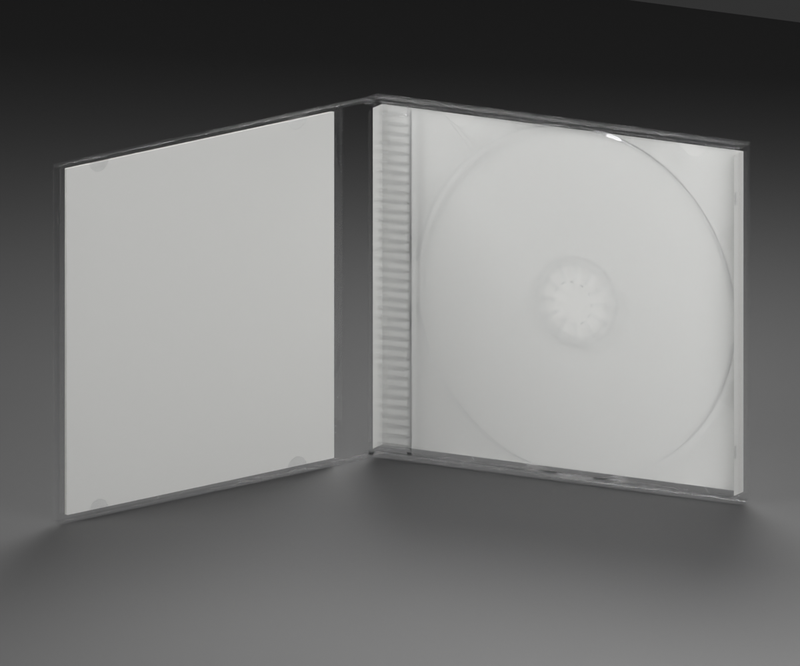

# PlayStation 1 — clear-tray jewel case template

**Version:** 0.1.0 · **Date:** 2026-10-16 · **Creator:** Lincoln Aleixo

A clean standard jewel case with a clear removable tray, hinged lid, disc-retaining hub, blank booklet and a two-sided folded tray card.





- A standard-compatible 142.35 × 124.75 × 10.4 mm envelope with a separate front-lid pivot.
- Clear molded lid and removable tray with a central retaining hub and approximate rib, clip and hinge detail.
- Independent front booklet, booklet reverse, rear wrap and inner wrap artwork targets; spine folds share the tray-card UV field.
- The Open clip rotates the lid to 110 degrees. The standalone CD remains a separate media asset.

## Import contract

| Property | Value |
| --- | --- |
| Units and axes | Meters; X width, Y up, +Z front |
| Pivot | Bottom center of the nominal closed envelope |
| Nominal closed size | 142.35 × 124.75 × 10.4 mm |
| Initial pose | Closed |
| Animation | `Open`, 0 to 2 seconds |
| Game media | None; cartridge/CD assets are separate |

The editable source preserves separate packaging parts. The portable GLB keeps named artwork surfaces, hinge nodes and removable-insert anchors. Artwork is confined to exterior or explicitly designated paper faces; inner carton stock remains unprinted. These are pristine materials without simulated wear, stains or yellowing.

### Artwork targets

| Named surface | Artwork slot |
| --- | --- |
| `FrontLabel` | `Front` |
| `InsertInnerPaper` | `BookletBack` |
| `RearLabel` | `WrapBack` |
| `TrayCardInside` | `WrapInside` |

Slots use normalized UV coordinates with upright exterior print orientation. A slot may span several named pieces; those pieces share a continuous UV field where a die cut or fold interrupts the paper. The neutral surfaces carry no game artwork.

### Articulation

The `Open` clip preserves a closed frame at 0 seconds and the inspection opening at 2 seconds. Named hinge nodes: `FrontLid`. Hinge extras record the axis, endpoint quaternions and opening phase. Paper and flexible plastic are approximated by rigid articulated parts, not a deformation simulation.

## Validation and limitations

The self-contained GLB passed structural geometry, hierarchy, artwork UV, embedded-resource and animation-endpoint checks. Godot 4.7.2-stable (official) imported it and verified both Open endpoints, named parts and artwork surfaces. Blender 5.2.2 LTS reopened the editable source and checked both poses. Exact binary hashes and measured differences are included in the release validation reports.

The envelope uses midpoint values from CMC assembly inspection ranges, not proof of the original Sony supplier. Fine molded features, booklet leaves and paper-fit dimensions are approximate. Clear plastic rendering depends on the importing engine. No manuals with printed content, promotional inserts, shrinkwrap or game media are included. A detached-insert image, where provided, is a separate inspection arrangement; it does not change the default Open clip.

## Generate and review

From the repository root:

```sh
blender -b --python tools/create_game_boxes.py -- --console playstation-1
python3 tools/inspect_game_box.py dist/game-boxes-20261016/templates/playstation-1-box/playstation-1-box.glb
```

The release contains editable `.blend`, portable `.glb`, six standard views, construction metadata, reference evidence, validation reports and license notices. The repository retains versioned preview snapshots and metadata. See [credits](CREDITS.md) and [changelog](CHANGELOG.md).

Original contributions: CC BY-NC-ND 4.0. Product designs and third-party marks are excluded. No game artwork, source photograph or copied logo is included.
