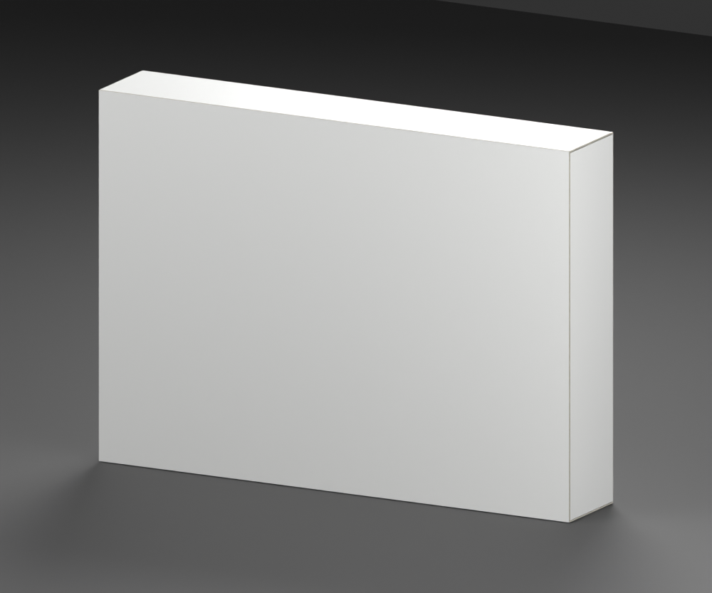
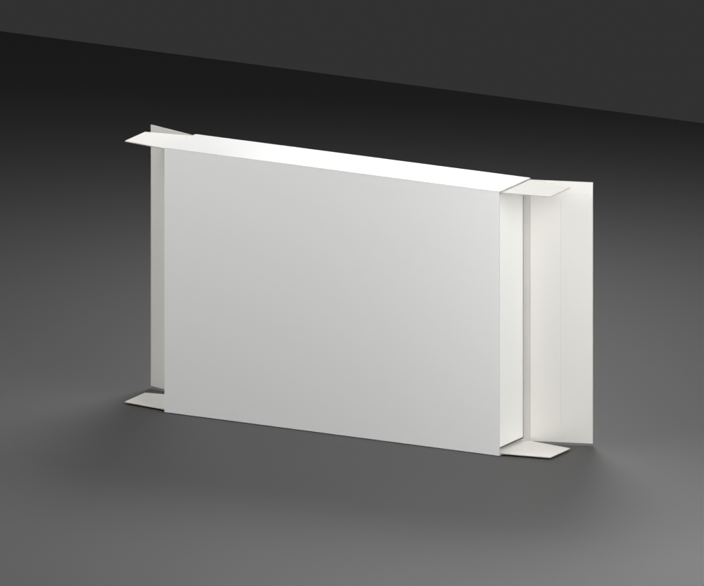
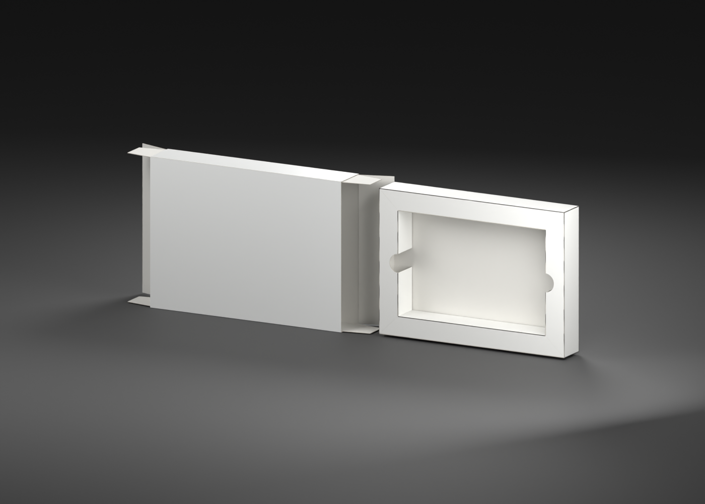

# Super Nintendo — western retail box template

**Version:** 0.1.0 · **Date:** 2026-10-16 · **Creator:** Lincoln Aleixo

A pristine landscape carton with two articulated end closures, tuck tongues, dust ears and a removable folded tray fitted to the western SNES cartridge envelope.





- Real-thickness coated paperboard tube with unprinted inner stock, exposed cut edges, scored folds and a glue lap.
- Left and right printed end panels have independent tuck tongues and upper/lower dust ears.
- The removable white tray uses hollow folded rails, a 138 × 89.5 mm approximate cartridge opening, finger notches and tucked corner ears.
- The normal Open clip leaves the tray seated; its extraction axis and optional translation are recorded separately.

## Import contract

| Property | Value |
| --- | --- |
| Units and axes | Meters; X width, Y up, +Z front |
| Pivot | Bottom center of the nominal closed envelope |
| Nominal closed size | 179 × 128 × 31 mm |
| Initial pose | Closed |
| Animation | `Open`, 0 to 2 seconds |
| Game media | None; cartridge/CD assets are separate |

The editable source preserves separate packaging parts. The portable GLB keeps named artwork surfaces, hinge nodes and removable-insert anchors. Artwork is confined to exterior or explicitly designated paper faces; inner carton stock remains unprinted. These are pristine materials without simulated wear, stains or yellowing.

### Artwork targets

| Named surface | Artwork slot |
| --- | --- |
| `ArtworkBack` | `Back` |
| `ArtworkBottom` | `Bottom` |
| `ArtworkFront` | `Front` |
| `ArtworkTop` | `Top` |
| `ArtworkSpineLeft` | `SpineLeft` |
| `ArtworkSpineRight` | `SpineRight` |

Slots use normalized UV coordinates with upright exterior print orientation. A slot may span several named pieces; those pieces share a continuous UV field where a die cut or fold interrupts the paper. The neutral surfaces carry no game artwork.

### Articulation

The `Open` clip preserves a closed frame at 0 seconds and the inspection opening at 2 seconds. Named hinge nodes: `LeftTuckTongueHinge`, `LeftEndFlapHinge`, `LeftLowerDustFlapHinge`, `LeftUpperDustFlapHinge`, `RightTuckTongueHinge`, `RightEndFlapHinge`, `RightLowerDustFlapHinge`, `RightUpperDustFlapHinge`. Hinge extras record the axis, endpoint quaternions and opening phase. Paper and flexible plastic are approximated by rigid articulated parts, not a deformation simulation.

## Validation and limitations

The self-contained GLB passed structural geometry, hierarchy, artwork UV, embedded-resource and animation-endpoint checks. Godot 4.7.2-stable (official) imported it and verified both Open endpoints, named parts and artwork surfaces. Blender 5.2.2 LTS reopened the editable source and checked both poses. Exact binary hashes and measured differences are included in the release validation reports.

Protector-fit dimensions establish an approximate envelope. Paper gauge, tray aperture, flap lengths and folds are inferred from photographs, not measured factory die lines. No manuals with printed content, promotional inserts, shrinkwrap or game media are included. A detached-insert image, where provided, is a separate inspection arrangement; it does not change the default Open clip.

## Generate and review

From the repository root:

```sh
blender -b --python tools/create_game_boxes.py -- --console snes
python3 tools/inspect_game_box.py dist/game-boxes-20261016/templates/snes-box/snes-box.glb
```

The release contains editable `.blend`, portable `.glb`, six standard views, construction metadata, reference evidence, validation reports and license notices. The repository retains versioned preview snapshots and metadata. See [credits](CREDITS.md) and [changelog](CHANGELOG.md).

Original contributions: CC BY-NC-ND 4.0. Product designs and third-party marks are excluded. No game artwork, source photograph or copied logo is included.

## Detached insert inspection


